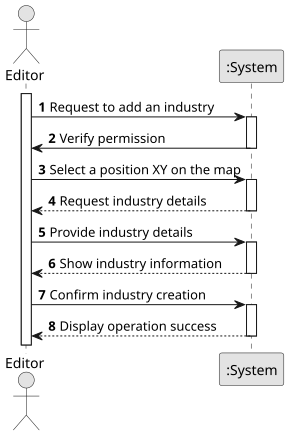

# US02 - Creating an Industry

## 1. Requirements Engineering

_In this section, it is suggested to capture the requirement description and specifications as provided by the client as well as any further clarification on it. It is also suggested to capture the requirements acceptance criteria and existing dependencies to other requirements. Finally, identify the involved input and output data and depict an Actor-System interaction in order to fulfill the requirement._

### 1.1. User Story Description

As an Editor, I want to add an industry in a position XY of
the selected map
### 1.2. Customer Specifications and Clarifications 

As the editor, we should be able to create an industry type building in a part of the chosen map with the specified x and y position values
### 1.3. Acceptance Criteria

Unspecified
### 1.4. Found out Dependencies

Max X,Y values dependent on map size (US01)
### 1.5 Input and Output Data

Input: Position values(X,Y), Industry description(Type)\
Output: Display created industry
### 1.6. System Sequence Diagram (SSD)

_Insert here a SSD depicting the envisioned Actor-System interactions and throughout which data is inputted and outputted to fulfill the requirement. All interactions must be numbered._

### 1.7 Other Relevant Remarks

System should give a modification historic