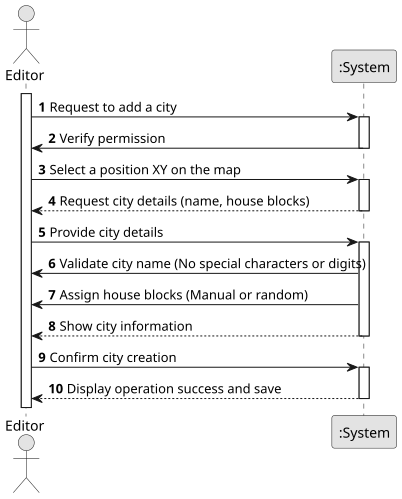

# US03 - Creating a city

## 1. Requirements Engineering

_In this section, it is suggested to capture the requirement description and specifications as provided by the client as well as any further clarification on it. It is also suggested to capture the requirements acceptance criteria and existing dependencies to other requirements. Finally, identify the involved input and output data and depict an Actor-System interaction in order to fulfill the requirement._

### 1.1. User Story Description

As an Editor, I want to add a city in a position XY of the selected
map, with a name and a positive number of house blocks
### 1.2. Customer Specifications and Clarifications 

As the Editor, we should be able to create a city in a specific X,Y position of the map with a custom name and number of house type buildings
### 1.3. Acceptance Criteria

AC1: A city
name cannot have special characters or digits.\
AC2: The house blocks can be assigned manually or automatically (randomly around the city tag position)

### 1.4. Found out Dependencies

Max X,Y values dependent on map size (US01)
### 1.5 Input and Output Data

Input: Position values(X,Y), Name, Number of House type buildings, Manual or Random house positions\
Output: Display created city
### 1.6. System Sequence Diagram (SSD)

_Insert here a SSD depicting the envisioned Actor-System interactions and throughout which data is inputted and outputted to fulfill the requirement. All interactions must be numbered._

### 1.7 Other Relevant Remarks

 There should be a time limit on how quickly a deletion can be undone in the system.