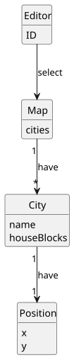

# US03 - As an Editor, I want to add a city in a position XY of the selected map, with a name and a positive number of house blocks.

## 2. Analysis

### 2.1. Relevant Domain Model Excerpt 
_In this section, it is suggested to present an excerpt of the domain model that is seen as relevant to fulfill this requirement._

### 2.2. Other Remarks

 A city name cannot have special characters or digits
 The house blocks can be assigned manually or automatically (randomly around the city
 tag position)