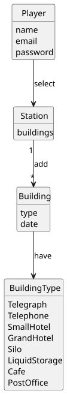

# US06 - As a Player, I want to upgrade a selected station with a building

## 2. Analysis

### 2.1. Relevant Domain Model Excerpt 
_In this section, it is suggested to present an excerpt of the domain model that is seen as relevant to fulfill this requirement._

### 2.2. Other Remarks

hotel can be small or grand\
telegraph can be replaced later with a phone\
There are no automatic updates; When a new building is available, the player can buy it and then the previous building is replaced.\
There are buildings that are mutually exclusive, such as small restaurants and large restaurants.\
There are buildings that, when they come into existence, it is no longer possible to build the previous one, for example, the telegraph was replaced by the telephone. Stations that have a telegraph continue to have the telegraph in operation until a telephone is built to replace the telegraph. From the moment that a telephone exists, it is no longer possible to build a telegraph.\
There cannot be multiple identical buildings (for example, I cannot have 3 grain silos).\
All combinations are possible, as long as the restrictions mentioned above are respected.
