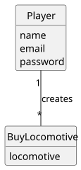

# USXXX - YYY

US09 - As a Player, I want to buy a train

## 2. Analysis

### 2.1. Relevant Domain Model Excerpt 
_In this section, it is suggested to present an excerpt of the domain model that is seen as relevant to fulfill this requirement._

### 2.2. Other Remarks

Locomotives can be of steam, diesel and electricity.
Electric Locomotives need electrified lines
