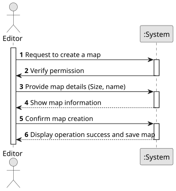

# US01 - Creating a Map

## 1. Requirements Engineering

### 1.1. User Story Description

As an Editor, I want to create a map with a size and a name

### 1.2. Customer Specifications and Clarifications 

>  Criar uma interface gráfica baseada em tkinter, onde seja possível visualizar os locais e os eventos do jogo num mapa.

> A ideia é que o utilizador possa ver num mapa interativo:
> A posição dos locais e os eventos que ocorrem nesses locais.

**From the client clarifications:**

> **Question:** Considering the map will need to accommodate multiple cities,industries and stations with their respective connections, would it be acceptable to establish a minimum map size like 20x20 or 50x50? A smaller size might not provide enough space for meaningful simulation elements.
> 
> **Answer:** Yes, you can define a minimum size

> **Question:** Does the size of the map have to be a real number or does it need to be an integer?
> 
> **Answer:** The map is a set of cells, similar to a spreadsheet. The coordinates are integers (row and column, or alternatively X and Y)
### 1.3. Acceptance Criteria

AC1: The maps dimensions are positive integers.\
AC2: Map name should be a valid file name.

### 1.4. Found out Dependencies
There aren't any dependencies on other US

### 1.5 Input and Output Data
**Input Data:**

* Typed data:
  * A name for the map
  * A width value for the map 
  * A height value for the map

* Selected data:
  * An organization to which the map belongs (if applicable)

**Output Data**
* Success or failure of the operation
* Error message if the input is invalid (e.g., empty name, negative dimensions)
* (Optional) Confirmation message with map ID or initial map preview
### 1.6. System Sequence Diagram (SSD)

### 1.7 Other Relevant Remarks

* The system should validate inputs before proceeding with map creation.
* If the operation fails, the system should display a clear error message indicating the reason (e.g., invalid data, lack of permissions).
* Upon success, the newly created map should be stored and become available for later editing or viewing in the interface.