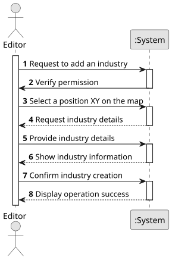

# US02 - Creating an Industry

## 1. Requirements Engineering

_In this section, it is suggested to capture the requirement description and specifications as provided by the client as well as any further clarification on it. It is also suggested to capture the requirements acceptance criteria and existing dependencies to other requirements. Finally, identify the involved input and output data and depict an Actor-System interaction in order to fulfill the requirement._

### 1.1. User Story Description

As an Editor, I want to add an industry (selected from the
available industries) in a position XY of
the selected (current) map
### 1.2. Customer Specifications and Clarifications 
> Industries are a type of location that can be placed on a map during scenario editing. They are essential for the production and transformation of cargo during the simulation phase.

**From the client clarifications:**
>**Question:** As an editor, are there limits to how many industries/factories can be placed on the map?
>
> **Answer:** No, there aren't

>**Question:** Do we have to considerate if there are industries there are close together? For example, it would be unnecessary for primary sector industries to be close to ports, because they have to be transformed in order to be transported.
>
> **Answer:** No, ports will have different behaviour depending on the settings defined for the scenario!

### 1.3. Acceptance Criteria
AC1: The coordinates must be within the bounds of the selected map. 
AC2: There must be no overlap with other entities (e.g., another industry, city) in the same position. 
AC3: The selected industry must be valid (predefined in the system). 
AC4: There can be only one industry per position.

### 1.4. Found out Dependencies

There is a dependecy on the US01- "Create a Map", because the maximum values of X and Y depends os the size of the map
### 1.5 Input and Output Data

**Input Data:**

* Typed data:
   * Name
   * Type of industry (primary, transforming, mixed)
   * A transformation rule (only if the industry is transforming)
   * A cargo type (only if the industry is primary)
   * X coordinate
   * Y coordinate
  
* Selected data:
  * A map (to which the industry will be added)

**Output Data:**
  * List of available industry types
  * (In)Success of the operation
### 1.6. System Sequence Diagram (SSD)

_Insert here a SSD depicting the envisioned Actor-System interactions and throughout which data is inputted and outputted to fulfill the requirement. All interactions must be numbered._

### 1.7 Other Relevant Remarks
* The coordinates (X, Y) must be within the bounds of the selected map.
* Only predefined industry types can be used; new industry types cannot be created by the user.
* The operation should provide appropriate feedback if any validation fails (e.g., invalid position, missing data, or duplication).