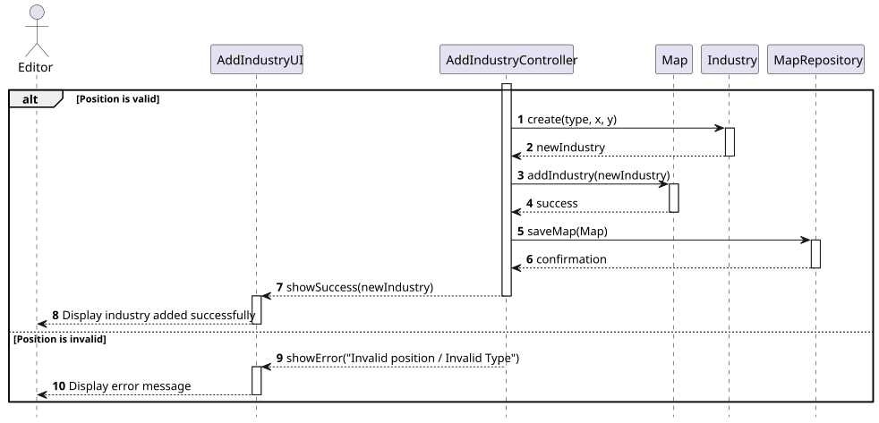
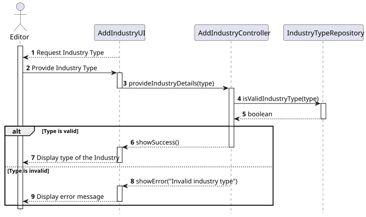
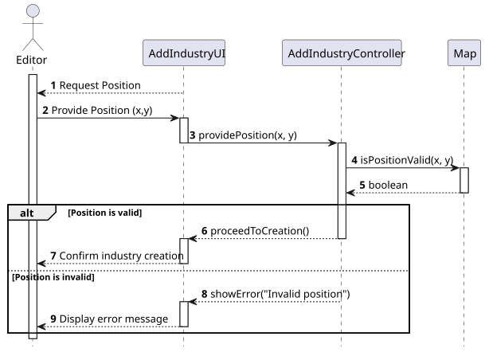
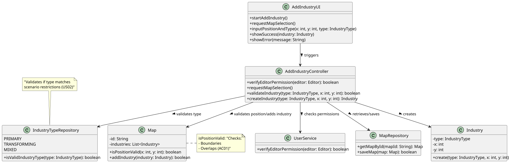

# US02 - Add an Industry to the Map

## 3. Design

### 3.1. Rationale

**The rationale grounds on the SSD interactions and the identified input/output data.**

| Interaction ID | Question: Which class is responsible for... | Answer                 | Justification (with patterns)                                                                                     |
|:-------------  |:--------------------------------------------|:-----------------------|:------------------------------------------------------------------------------------------------------------------|
| Step 1         | ... interacting with the actor (Editor)?    | AddIndustryUI          | Pure Fabrication: Dedicated UI class handles user interaction.                                                    |
|                | ... coordinating the US?                    | AddIndustryController  | Controller pattern: Mediates between UI and domain logic.                                                         |
|                | ... verifying editor permissions?           | UserService            | IE: Centralizes user role validation.                                                                             |
|                | ... knowing the current map being edited?   | MapRepository          | IE: Repository holds all maps.                                                                                    |
| Step 2         | ... validating industry types?              | IndustryTypeRepository | IE: Maintains scenario-specific industry types (primary/transforming/mixed).                                      |
| Step 3         | ... validating XY coordinates?              | Map                    | IE: Map knows its dimensions and occupied positions (AC01: Overbuilding prevention).                              |
| Step 4         | ... instantiating a new industry?           | Industry               | Creator (Rule 2): Industry encapsulates creation logic (type/position validation).                                |
|                | ... adding industry to map?                 | Map                    | IE: Map manages spatial containment of industries.                                                                |
| Step 5         | ... persisting the updated map?             | MapRepository          | IE: Repository handles persistence.                                                                               |
| Step 6         | ... confirming success to the user?         | AddIndustryUI          | Pure Fabrication: UI provides user feedback.                                                                      |

### Systematization

According to the taken rationale, the conceptual classes promoted to software classes are:

#### Conceptual classes promoted to software classes:
- **Map**
    - Manages spatial data and industry placement.
- **Industry**
    - Validates its own constraints (e.g., position rules).
- **IndustryType** (enum: `PRIMARY`, `TRANSFORMING`, `MIXED`)
    - Matches project requirements (US02).

#### Pure Fabrications:
- **AddIndustryUI**
    - Handles user input/output (no domain logic).
- **AddIndustryController**
    - Orchestrates the workflow (Controller pattern).
- **MapRepository** / **IndustryTypeRepository**
    - Persistence and type management (Repository pattern).
- **UserService**
    - Centralizes permission checks.

## 3.2. Sequence Diagram (SD)

### Full Diagram
This diagram shows the complete sequence of interactions between the classes involved in the realization of US02.

### Partial Diagrams
These partial diagrams break down the full sequence into logical steps.

#### Permission Verification and Map Selection
This part of the sequence illustrates how the industry addition process is initiated by the Editor. The user interacts with the AddIndustryUI to begin the process. The AddIndustryController then checks whether the user has permission to perform this operation by calling the UserService.

####  Industry Type 

This section shows how the user selects the industry’s position on the map and provides the type of industry to be added. The AddIndustryController validates the type against the IndustryTypeRepository to ensure it's allowed.

#### Position Validation

#### Industry Creation and Saving
This part focuses on validating the chosen position and preparing a preview of the new industry. It retrieves the map, checks if the position is valid, and creates a temporary industry object. This object is then displayed to the editor for confirmation.

## 3.3. Class Diagram (CD)

