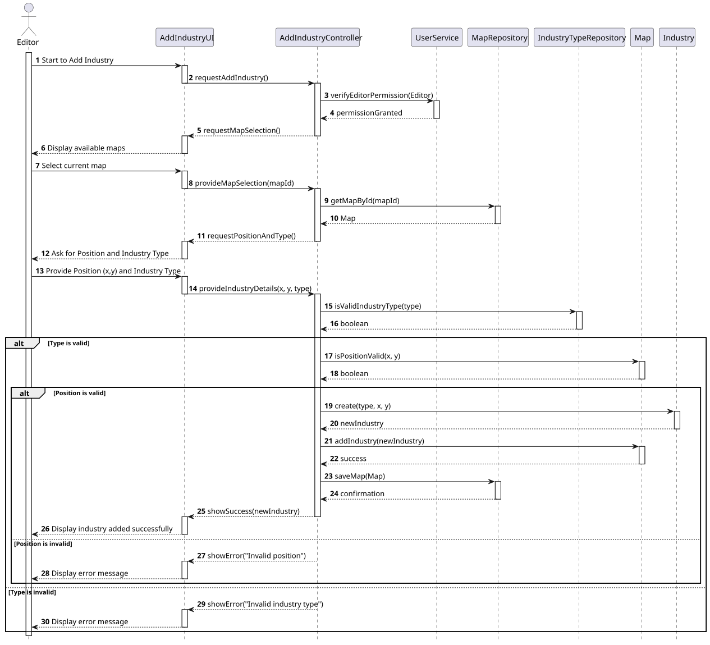
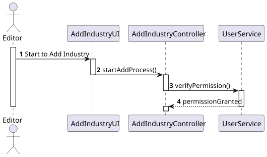
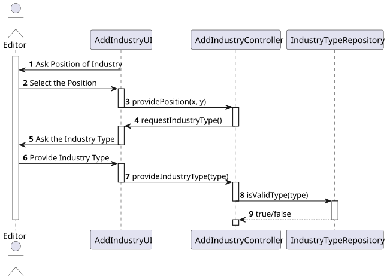
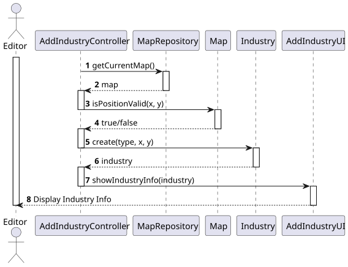
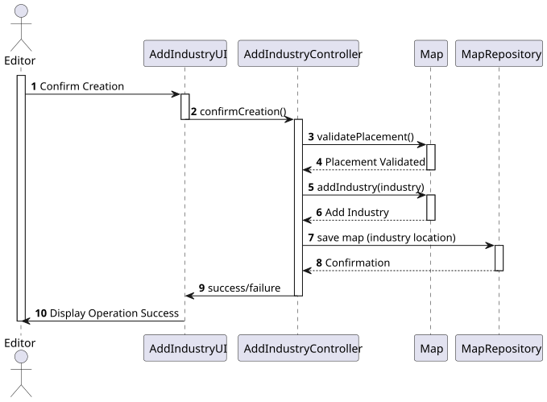

# USXXX - YYY

_XXX stands for User Story number and YYY for User Story description (e.g. US006 - Create a Task)_

## 3. Design

### 3.1. Rationale

**The rationale grounds on the SSD interactions and the identified input/output data.**

| Interaction ID | Question: Which class is responsible for... | Answer                 | Justification (with patterns)                                                                                     |
|:-------------  |:--------------------------------------------|:-----------------------|:------------------------------------------------------------------------------------------------------------------|
| Step 1  		 | ... interacting with the actor (Editor)?	   | AddIndustryUI          | Pure Fabrication: UI class handles user interaction.                                                              |
|                | ... coordinating the US?                    | AddIndustryController  | Controller pattern: mediates between UI and domain logic.                                                         |
|                | ... knowing the current map being edited?   | MapRepository          | IE: Repository holds all maps.                                                                                    |
| Step 2  		 | ... listing available industry types?       | IndustryTypeRepository | IE: Maintains industry types (primary/transforming/mixed).                                                        |
| Step 3  		 | ... validating XY coordinates on the map?   | Map                    | IE: Map knows its dimensions and valid positions.                                                                 |
| Step 4  		 | ... instantiating a new industry?           | Map                    | Creator (Rule 1): Map contains industries.                                                                        |
|                 | ... validating industry placement rules?    | Industry               | IE: Industry validates its own constraints (e.g., no overlap).                                                    |
| Step 5  		 | ... persisting the updated map?             | MapRepository          | IE: Repository manages map persistence.                                                                           |
| Step 6  		 | ... confirming success to the user?         | AddIndustryUI          | Pure Fabrication: UI handles feedback.                                                                            |              

### Systematization ##

According to the taken rationale, the conceptual classes promoted to software classes are:
#### Conceptual classes promoted to software classes:
* Map
* Industry
* IndustryType (enum: PRIMARY/TRANSFORMING/MIXED)

#### Pure Fabrications:

* AddIndustryUI
* AddIndustryController
* MapRepository
* IndustryTypeRepository

## 3.2. Sequence Diagram (SD)

### Full Diagram
This diagram shows the complete sequence of interactions between the classes involved in the realization of US02.

### Partial Diagrams
These partial diagrams break down the full sequence into logical steps.

#### Start Process and Permission Check
This part of the sequence illustrates how the industry addition process is initiated by the Editor. The user interacts with the AddIndustryUI to begin the process. The AddIndustryController then checks whether the user has permission to perform this operation by calling the UserService.

####  Input Position and Industry Type

This section shows how the user selects the industry’s position on the map and provides the type of industry to be added. The AddIndustryController validates the type against the IndustryTypeRepository to ensure it's allowed.

#### Validation and Industry Preview
This part focuses on validating the chosen position and preparing a preview of the new industry. It retrieves the map, checks if the position is valid, and creates a temporary industry object. This object is then displayed to the editor for confirmation.

#### Confirmation and Finalization

In the final phase, the editor confirms the industry creation. The controller validates placement again, adds the industry to the map, and saves the updated map. Finally, a success or failure message is shown to the editor.

## 3.3. Class Diagram (CD)

