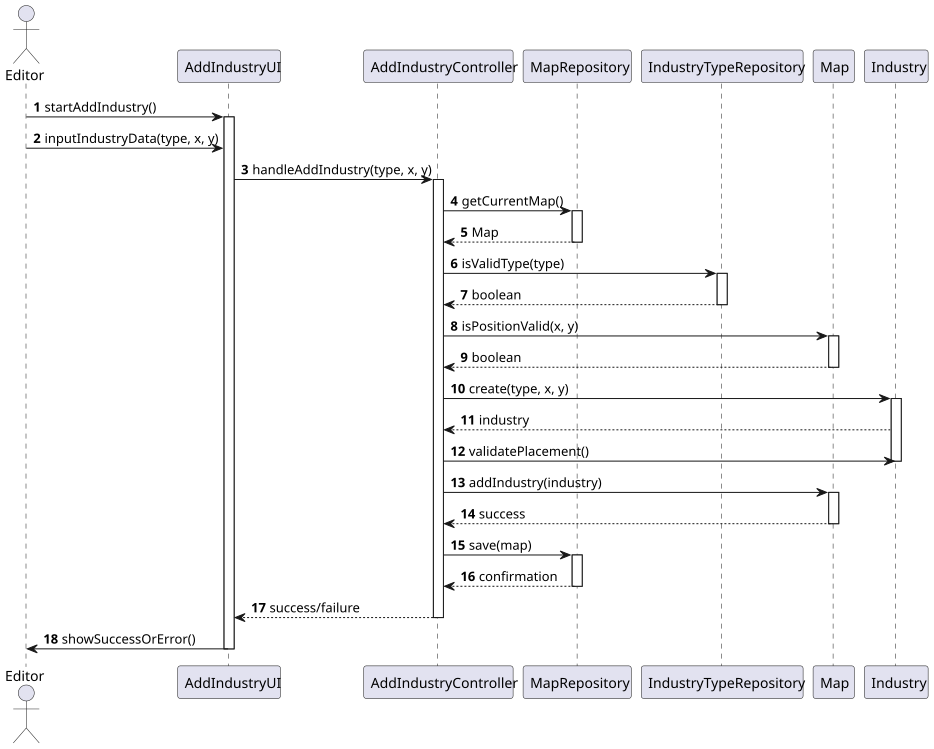
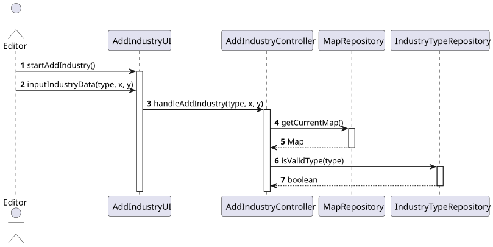
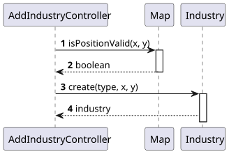
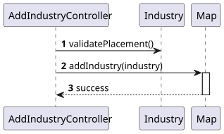
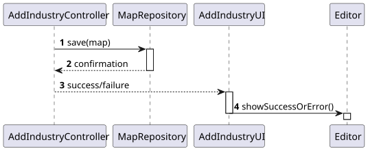
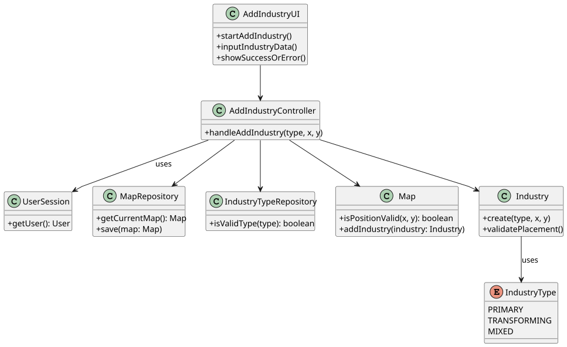

# USXXX - YYY

_XXX stands for User Story number and YYY for User Story description (e.g. US006 - Create a Task)_

## 3. Design

### 3.1. Rationale

**The rationale grounds on the SSD interactions and the identified input/output data.**

| Interaction ID | Question: Which class is responsible for... | Answer                 | Justification (with patterns)                                                                                     |
|:-------------  |:--------------------------------------------|:-----------------------|:------------------------------------------------------------------------------------------------------------------|
| Step 1  		 | ... interacting with the actor (Editor)?	   | AddIndustryUI          | Pure Fabrication: UI class handles user interaction.                                                              |
|                | ... coordinating the US?                    | AddIndustryController  | Controller pattern: mediates between UI and domain logic.                                                         |
|                | ... knowing the current map being edited?   | MapRepository          | IE: Repository holds all maps.                                                                                    |
| Step 2  		 | ... listing available industry types?       | IndustryTypeRepository | IE: Maintains industry types (primary/transforming/mixed).                                                        |
| Step 3  		 | ... validating XY coordinates on the map?   | Map                    | IE: Map knows its dimensions and valid positions.                                                                 |
| Step 4  		 | ... instantiating a new industry?           | Map                    | Creator (Rule 1): Map contains industries.                                                                        |
|                 | ... validating industry placement rules?    | Industry               | IE: Industry validates its own constraints (e.g., no overlap).                                                    |
| Step 5  		 | ... persisting the updated map?             | MapRepository          | IE: Repository manages map persistence.                                                                           |
| Step 6  		 | ... confirming success to the user?         | AddIndustryUI          | Pure Fabrication: UI handles feedback.                                                                            |              

### Systematization ##

According to the taken rationale, the conceptual classes promoted to software classes are:
#### Conceptual classes promoted to software classes:
* Map
* Industry
* IndustryType (enum: PRIMARY/TRANSFORMING/MIXED)

#### Pure Fabrications:

* AddIndustryUI
* AddIndustryController
* MapRepository
* IndustryTypeRepository

## 3.2. Sequence Diagram (SD)

### Full Diagram
This diagram shows the complete sequence of interactions between the classes involved in the realization of US02.

### Partial Diagrams
These partial diagrams break down the full sequence into logical steps.

#### Input & Validation Phase
The Editor provides the industry data, which is validated by the controller.

####  Map Position & Industry Creation

#### Validate Placement & Add to Map

#### UI Feedback

## 3.3. Class Diagram (CD)

