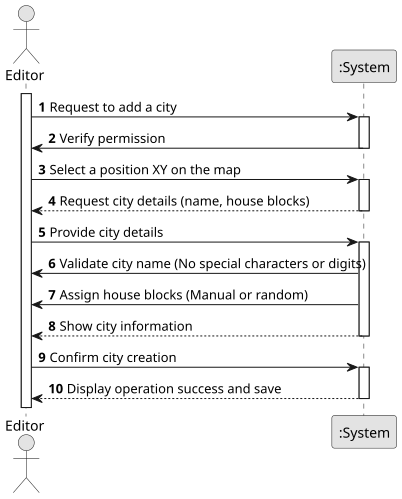

# US03 - Creating a city

## 1. Requirements Engineering

### 1.1. User Story Description

As an Editor, I want to add a city in a position XY of the selected
map, with a name and a positive number of house blocks
### 1.2. Customer Specifications and Clarifications 

> Uma cidade tem:
>* Nome
>* Localização (coordenadas XY no mapa)
>* Blocos habitacionais (que representam habitações).

>No simulador, as cidades:
>* Geram/consomem passageiros e correio.
>* Consomem produtos finais (ex.: comida, têxteis, carros).

**From the client clarifications:**
>**Question:** What exactly are "cities"? Are they entities that automatically produce people and mail based on the total number of house blocks, or do we also need to consider whether the house blocks themselves are located within the economic radius of a station? 
>**Answer:**
Cities are places with a name, a location and a number of house blocks. Each house block functions as an industry blocks but generates mail/passengers, and demand mail/passangers and final produts like food or goods.

>**Question:** Is there a minimum and/or maximum number of house blocks that can be placed when creating a city? 
>**Answer:** No, there isn't.

### 1.3. Acceptance Criteria

AC1: A city
name cannot have special characters or digits.\
AC2: The house blocks can be assigned manually or automatically (randomly around the city tag position)
AC3: City coordinates must be within the bounds of the existing map.
AC4: City names must be unique within a map.
AC5: The system must prevent overlapping city positions.

### 1.4. Found out Dependencies
This US is going to depend on US01, because the max X and Y values will depend on the size of the map.

### 1.5 Input and Output Data

**Input Data:**

*Typed data:*
* City name (text)
* Number of house blocks (positive integer)
* Optional: Manual XY coordinates for city center

*Selected data:*
* Target map selection
* Distribution mode (manual/automatic for house blocks)

**Output Data:**
* Success or failure of the operation

* Error message if:
  * Invalid city name
  *  Invalid house block count 
  * Coordinates outside map bounds 
  * Name conflict

* Visual representation of the city on the map
* (Optional) Generated house block coordinates when using automatic distribution
### 1.6. System Sequence Diagram (SSD)

_Insert here a SSD depicting the envisioned Actor-System interactions and throughout which data is inputted and outputted to fulfill the requirement. All interactions must be numbered._

### 1.7 Other Relevant Remarks

*The system should provide visual feedback during city placement, showing:*
* The city center marker
* House block positions (when using automatic distribution)
* Radius of influence (for future station placement)

*For automatic distribution:*
* House blocks should be visually distinct from the city center
* The distribution should avoid placing blocks outside map boundaries
* The algorithm should be deterministic for reproducibility

*City data should be persisted immediately upon successful creation.*

*The interface should:*
* Clearly indicate required vs optional fields
* Provide a preview of automatic distribution before confirmation
* Allow cancellation during the creation process

*Performance consideration:*
* The automatic distribution algorithm should complete within 1 second even for maximum block counts
* The system should handle at least 100 cities per map without performance degradation