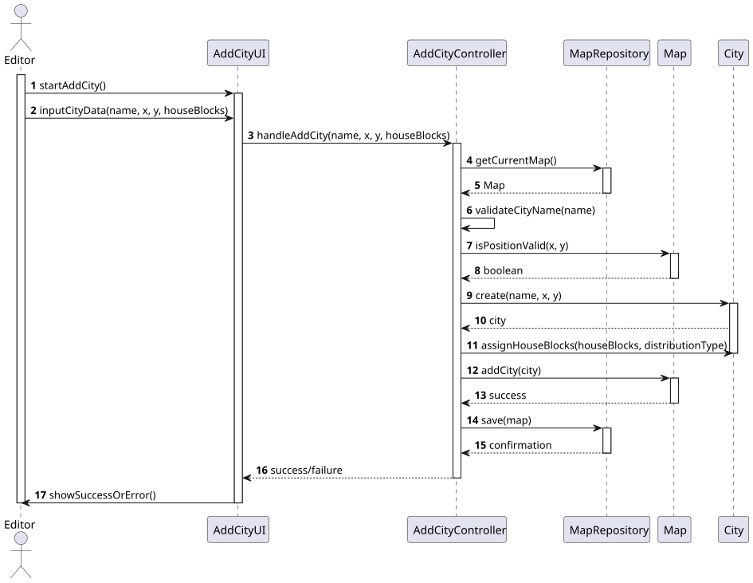
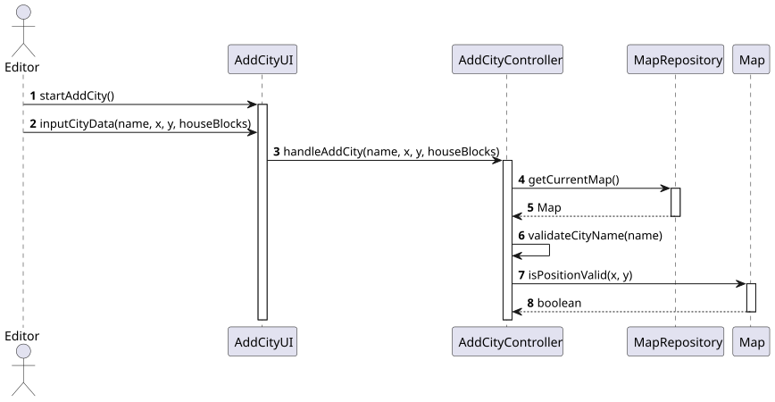
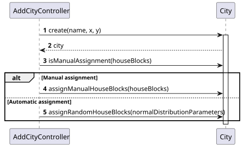
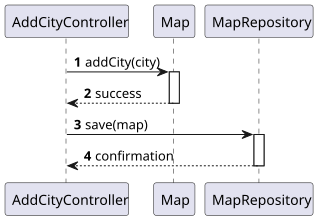
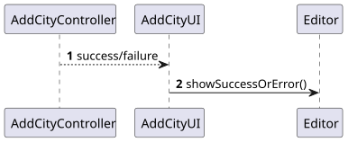
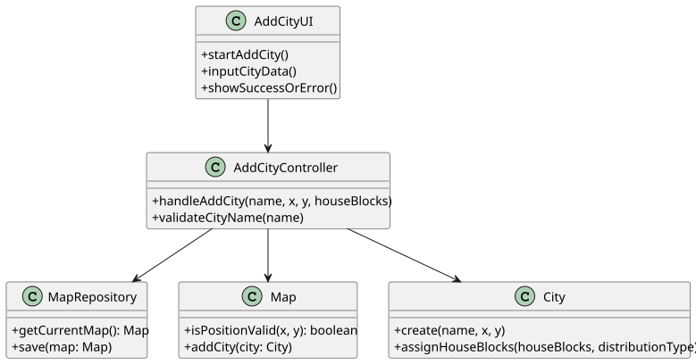

# USXXX - YYY

_XXX stands for User Story number and YYY for User Story description (e.g. US006 - Create a Task)_

## 3. Design

### 3.1. Rationale

**The rationale grounds on the SSD interactions and the identified input/output data.**

| Interaction ID | Question: Which class is responsible for...                   | Answer            | Justification (with patterns)                                                                                                          |
|:---------------|:--------------------------------------------------------------|:------------------|:---------------------------------------------------------------------------------------------------------------------------------------|
| Step 1  		     | Interacting with the actor (Editor)?                          | AddCityUI         | Pure Fabrication: UI class handles user interaction.                                                                                   |
|                | Coordinating the US?                                          | AddCityController | Controller: mediates between UI and domain logic.                                                                                      |
|                | Knowing the current map?                                      | MapRepository     | IE: Repository holds all maps.                                                                                                         |
| Step 2  		     | Validating the city name (no special characters, no digits)?	 | AddCityController | IE: Controller applies validation rules to city names.                                                                                 |
| Step 3  		     | Validating XY coordinates?                                    | Map               | IE: Map knows its dimensions and valid positions.                                                                                      |
| Step 4  		     | Creating a new City?                                          | Map               | Creator: The Map contains Cities; it is responsible for creating and managing them.                                                    |
| Step 5  		     | Validating city placement and assigning house blocks?         | City              | IE: City knows its own properties (name, coordinates, blocks) and assigns them, following rules (manual/random).                       |
| Step 6  		     | Persisting the updated map?                                   | MapRepository     | Repository: Manages map persistence.                                                                                                   |              
| Step 7  		     | Confirming success to the user?                               | AddCityUI         | Pure Fabrication: UI class handles feedback to user.                                                                                   |

### Systematization ##

According to the taken rationale, the conceptual classes promoted to software classes are:

* City
* Map

Other software classes (i.e. Pure Fabrication) identified:

* AddCityUI  
* AddCityController
* MapRepository
* AplicationSession
* UserSession

## 3.2. Sequence Diagram (SD)

### Full Diagram
This diagram shows the full sequence of interactions between the classes involved in the realization of this user story.

### Partial Diagrams

#### Input & Validation Phase
This diagram shows the interaction where the Editor inputs the city data and the controller validates the city name and coordinates.

#### Create City & Assign House Blocks
This diagram shows how the system creates a new city and assigns the house blocks either manually or randomly.

####  Add City to Map & Save Phase
This diagram illustrates how the created city is added to the map and the updated map is saved in the repository.

#### Feedback to UI Phase
This diagram shows how the controller informs the UI about the operation result, and the UI then presents it to the Editor.

## 3.3. Class Diagram (CD)

This diagram shows the main software classes involved in fulfilling the requirements of US03 and their relationships.

