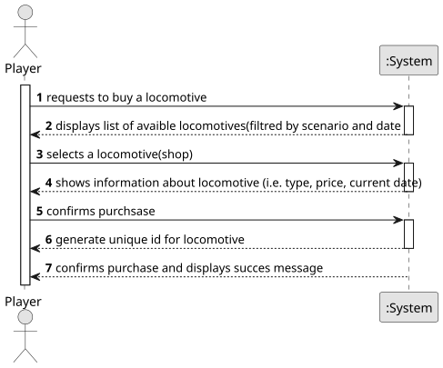

# US09 - As a Player, I want to buy a locomotive

## 1. Requirements Engineering

### 1.1. User Story Description

As a Player, I want to buy a locomotive

### 1.2. Customer Specifications and Clarifications 

**From specifications document:**

>Each locomotive is characterized by a set of key technical attributes essential for its operation within the railway network. There are three main types: steam, diesel, and electric — with electric locomotives requiring electrified lines. Their main characteristics include power, acceleration, and top speed. Additionally, each locomotive has an annual fuel and maintenance cost, as well as a purchase price.
**From the client clarifications:**

**From the client clarifications:**

> **Question:** Can a player buy the same train multiple times?
> 
> **Answer:** The same type of locomitve, yes; but these locomotives will have unique identification (like a plate or a serial number)

> **Question:**
Is there a limit to how many trains a player can own, like a inventory that can get full?
> 
> **Answer:** 
> There is no physical limit, just the available memory.

> **Question:**
> Can the player purchase multiple locomotives at once?
> 
>  **Answer:**
> Not planned.

### 1.3. Acceptance Criteria

* **AC1:** The player should choose the locomotive from a list of available
* **AC2:** locomotives for the scenario as well as a current date.

### 1.4. Found out Dependencies

* There is a dependency on US04 - As an Editor, I want to create a scenario for a selected map" because the implementation of this US is only possible if there is already a scenario created with locomotives defined as available and rules on temporal availability.

### 1.5 Input and Output Data

**Input Data:**

* Typed data:
  * Purchase request

* Selected data:
  * Selected locomotive from the available list (filtered by scenario and current date)
  * Confirms purchase

**Output Data:**

* List of available locomotives (filtered by scenario and date)

* Detailed information about the selected locomotive (type, price, current date)

* ID of the purchased locomotive

* Operation status

### 1.6. System Sequence Diagram (SSD)

### 1.7 Other Relevant Remarks

* A train is not a loocomotive ( train is a locomotive and the carriage)
* Locomotives can be of steam, diesel or electricity

