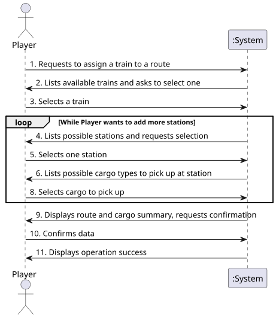

# US10 - As a Player, I want to assign a selected train to a route with valid stations and the respective list of cargoes to be picked up in eachstation

## 1. Requirements Engineering

### 1.1. User Story Description

As a Player, I want to assign a selected train to a route with
valid stations and the respective list of cargoes to be picked up in each
station

### 1.2. Customer Specifications and Clarifications 

**From the specifications document:**

>The player can put the train into service on a specific route. A route is a list of stations where the train passes, along which it loads (carriages) cargo at each station.

**From the client clarifications:**

> **Question:** If there is many stations but no railway lines, are we able to create a route?
> 
> **Answer:** If there is no path between any pair of consective points of the route, the player should be warned, then the player can opt between cancel/proceed.

> **Question:** Can multiple cargo types be assigned to the same train? 
> 
>**Answer:**
Yes

> **Question:** Does a train collect all the cargo available in a station or just the cargo required for other stations in its route?
>
>**Answer** It collects the defined in the route if available in the station otherwise it departs with the carriages empty.

### 1.3. Acceptance Criteria

unspecified

### 1.4. Found out Dependencies

* There is a dependency on "US05 - Building stations" to create a route with valid stations, those stations must already exist on the map.

* There is a dependency on "US08 - Building a rail line between stations" there must be  connections between stations for the train to travel along the route.

* There is a dependency on "US09 - Purchasing a locomotive" before assigning a train to a route, the train (locomotive + cargo) must have been purchased.

### 1.5 Input and Output Data

**Input Data:**

* Typed data:
  * Cargo types to be loaded at each station (multiple types allowed per station).

* Selected data:

   * A train (from the list of available trains).

   * An ordered list of stations (the route of the train).

**Output Data:**

* List of available stations.

* List of available cargo types per station.

* (In)Success of the route and cargo assignment operation.

### 1.6. System Sequence Diagram (SSD)

### 1.7 Other Relevant Remarks

* Stations should be valid to move the train to there route
