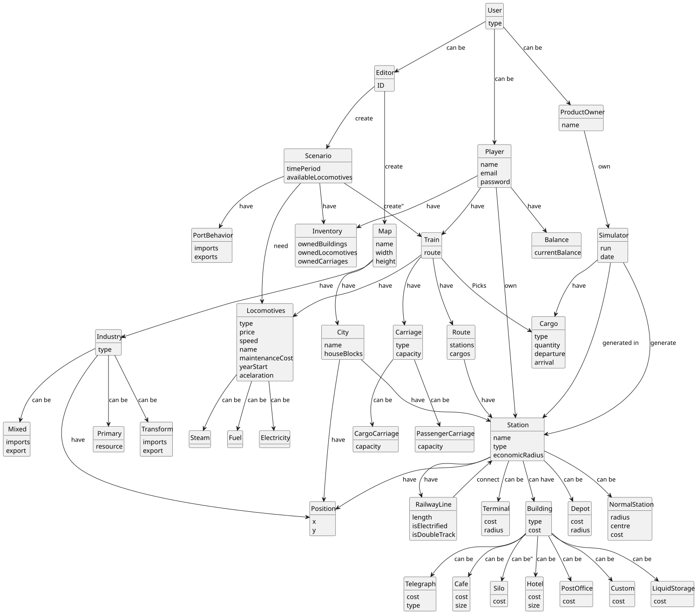

# OO Analysis

## Rationale to identify domain conceptual classes

### _Conceptual Class Category List_

**Business Transactions**

* *Route Assignment* - Assignment of a train to a specific route
* *Maintenance Operation* - Maintenance performed on railway lines
* *Purchase Transaction* - Purchase of locomotives or station upgrades

___

**Transaction Line Items**

* *Cargo Item* - Specific cargo being transported
* *Upgrade Item* - Specific station upgrade component

---

**Product/Service related to a Transaction or Transaction Line Item**

* *Locomotive* - Engine that powers trains
* *Carriage* - Vehicle for transporting cargo or passengers
* *Station Upgrade* - Building or facility that improves station operations

---

**Transaction Records**

* *Simulation Log* - Record of simulation events
* *Financial Record* - Track of profits/losses

---  

**Roles of People or Organizations**

* *Editor* - Creates maps and scenarios
* *Player* - Interacts with the simulation
* *Product Owner* - Oversees game development

---

**Places**

* *Map* - Game playing area
* *City* - Population center on the map
* *Industry* - Production facility on the map
* *Station* - Railway stop (Depot, Station, or Terminal)
* *Railway Line* - Connection between stations

---

**Noteworthy Events**

* *Cargo Generation* - Creation of new cargo at stations
* *Train Movement* - Movement of trains between stations
* *Historical Event* - Scenario-specific events affecting simulation

---

**Physical Objects**

* *Train* - Composition of locomotive and carriages
* *Building* - Physical station structures

---

**Descriptions of Things**

* *Locomotive Specs* - Technical details of locomotives
* *Cargo Type* - Description of cargo categories
* *Scenario Rules* - Constraints for a scenario

---

**Catalogs**

* *Locomotive Catalog* - Available locomotive types
* *Industry Catalog* - Available industry types
* *Upgrade Catalog* - Available station upgrades

---

**Containers**

* *Train Yard* - Collection of available trains
* *Station Inventory* - Cargo available at a station

---

**Elements of Containers**

* *Cargo Item* – A unit of cargo available at a station for pickup or delivery.
* *Carriage Item* – Represents a single carriage in a train composition, associated with a specific cargo type.
* *Upgrade Item* – Represents a station enhancement (e.g., café, silo, telegraph) that affects station performance or behavior.

---

**(Other) Organizations**

* *Manufacturer* – An entity responsible for building locomotives and carriages.
* *Distributor* – An organization that handles import/export operations, especially relevant in port scenarios where mixed industry logistics are defined.

---

**Other (External/Collaborating) Systems**

* *Save/Load System* – Allows game state persistence between simulation sessions.
* *Visualization Library* – External tools (e.g., Graphviz, GraphStream) used to generate visual representations of the railway network topology.
* *Authentication System* – Handles user login and credential validation.

---

**Records of finance, work, contracts, legal matters**

* *Contract* – Agreement for purchasing locomotives or accessing certain upgrades (e.g., exclusive technology rights in scenarios).
* *Invoice Record* – Captures cost details for purchases like station construction, line building, and train acquisition.
* *Work Log* – Logs maintenance operations and train movement history.

---

**Financial Instruments**

* *Credit Account* – Represents the available funds or budget allocated to the player within a scenario.
* *Transaction Token* – Internal representation of purchases made.
---

**Documents mentioned/used to perform some work**

* *Purchase Order* – Internal request for acquiring locomotives, carriages, or station upgrades.
* *Scenario File* – Configuration file defining map rules, time constraints, available technology, and event triggers.
* *Simulation Report* – Output document or log that summarizes performance metrics and KPIs during a simulation run.

---

## Rationale to identify associations between conceptual classes

An association is a relationship between instances of objects that indicates a relevant connection and that is worth of remembering, or it is derivable from the List of Common Associations: 

| Concept (A)         | Association               | Concept (B)           |
|---------------------|---------------------------|------------------------|
| Map                 | contains                  | City                  |
| Map                 | contains                  | Industry              |
| Map                 | contains                  | Station               |
| Scenario            | defines rules for         | Map                   |
| Scenario            | enables                   | Locomotive Type       |
| Scenario            | defines behavior for      | Port                  |
| Editor              | creates                   | Map                   |
| Editor              | creates                   | Scenario              |
| Player              | builds                    | Station               |
| Player              | builds                    | Railway Line          |
| Player              | purchases                 | Locomotive            |
| Player              | assigns                   | Train                 |
| Player              | defines                   | Route                 |
| Train               | is composed of            | Locomotive + Carriage |
| Route               | contains                  | Station               |
| Station             | has inventory of          | Cargo Item            |
| Station             | is upgraded with          | Station Upgrade       |
| Station             | is connected to           | Railway Line          |
| Railway Line        | connects                  | Station               |
| Train               | follows                   | Route                 |
| Train               | transports                | Cargo Item            |
| Industry            | generates or consumes     | Cargo Item            |
| City                | generates or consumes     | Cargo Item            |
| Simulation Log      | records                   | Train Movement        |
| Simulation Log      | records                   | Cargo Generation      |
| Financial Record    | logs                      | Purchase Transaction  |
| Visualization Tool  | displays                  | Railway Network Graph |
| Train               | is tracked in             | Simulation Log        |
| Station Upgrade     | is available from         | Upgrade Catalog       |
| Locomotive          | is listed in              | Locomotive Catalog    |
| Industry            | is listed in              | Industry Catalog      |
| Locomotive          | has description in        | Locomotive Specs      |
| Carriage            | transports                | Cargo Type            |
| Cargo Generation    | occurs at                 | Station               |
| Maintenance Route   | traverses                 | Railway Line          |
| Historical Event    | influences                | Scenario              |
| Authentication System | authenticates           | Player                |
| Visualization Tool  | renders                   | Graph Representation  |

## Domain Model

