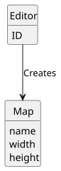

# US01 - As an Editor, I want to create a map with a size and a name.

## 2. Analysis

### 2.1. Relevant Domain Model Excerpt 

### 2.2. Other Remarks

* The name of the map must be unique in the system to avoid conflicts.
* The map creation interface must be intuitive, allowing the Editor to easily input the dimensions and the name.
* Validations must be implemented to ensure that the map dimensions are positive integers.
* The system must provide immediate feedback if the acceptance criteria are not met (e.g., invalid name or non-positive dimensions).
* The created map must be persisted in the system for future use in the scenario editor or simulator.