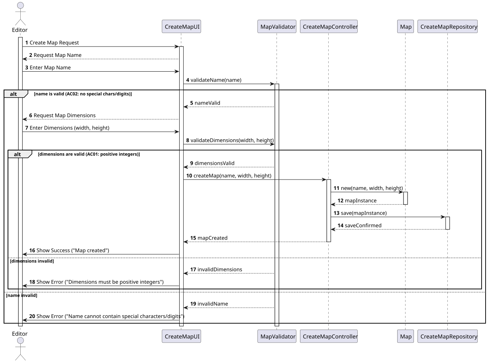
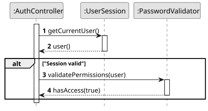
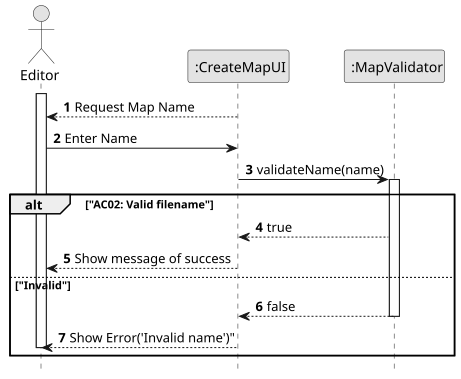
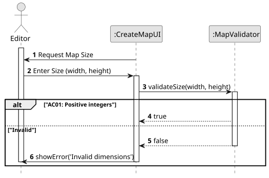
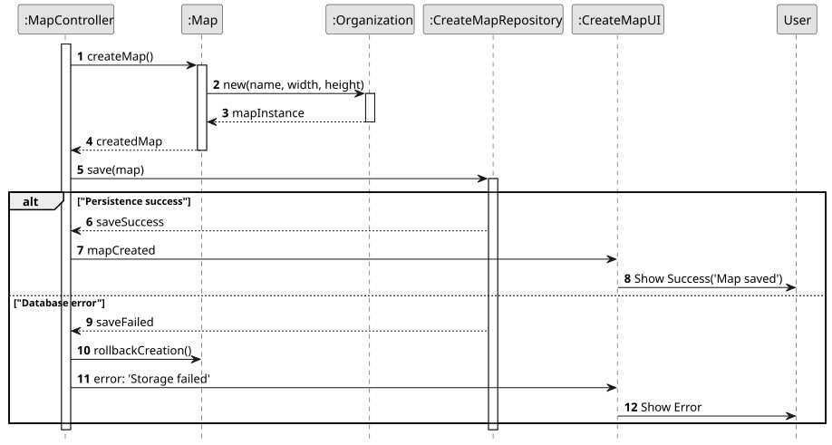
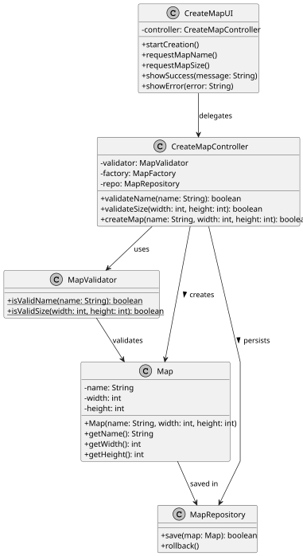

# US01 - As an Editor, I want to create a map with a size and a name.

## 3. Design

### 3.1. Rationale

**The rationale grounds on the SSD interactions and the identified input/output data.**

| Interaction ID | Question: Which class is responsible for...                      | Answer                  | Justification (with patterns)                                                                                                                           |
|:---------------|:-----------------------------------------------------------------|:------------------------|:--------------------------------------------------------------------------------------------------------------------------------------------------------|
| Step 1         | ... interacting with the Editor?                                 | CreateMapUI             | Pure Fabrication: separates UI responsibility from domain logic.                                                                                        |
| Step 2         | ... coordinating the flow of the use case?                       | CreateMapController     | Controller: mediates between UI and domain logic.                                                                                                       |
| Step 3         | ... knowing the authenticated user?                              | UserSession             | Information Expert: maintains session data.                                                                                                             |
| Step 4         | ... requesting the name and dimensions of the map from the user? | CreateMapUI             | Information Expert: handles user input.                                                                                                                 |
| Step 5         | ... validating the map name (valid file name)?                   | MapValidator            | Strategy Pattern: encapsulates validation rules that can vary independently.                                                                            |
| Step 6         | ... validating the map dimensions (positive integers)?           | MapValidator            | Information Expert: centralizes all validation logic.                                                                                                   |
| Step 7         | ... creating the map instance?                                   | MapFactory              | Factory Method: encapsulates creation logic and ensures valid object state.                                                                             |
| Step 8         | ... knowing the map data (name and dimensions)?                  | Map                     | Information Expert: owns the core domain data.                                                                                                          |
| Step 9         | ... storing the created map?                                     | MapRepository           | Repository: handles persistence with transaction support.                                                                                               |              
| Step 10        | ... informing the result of the operation to the UI?             | CreateMapController     | Controller: relays outcomes between layers.                                                                                                             |
| Step 11        | ... displaying success/error messages?                           | CreateMapUI             | Information Expert: manages user feedback.                                                                                                              |

### Systematization ##

According to the taken rationale, the conceptual classes promoted to software classes are:

* Map
* User (extended with permissions)

Other software classes (i.e. Pure Fabrication) identified:

* CreateMapUI
* CreateMapController
* MapValidator
* MapFactory
* MapRepository
* UserSession
* MapConfig 

## 3.2. Sequence Diagram (SD)

### Full Diagram
This diagram shows the complete sequence of interactions between the classes involved in the realization of this user story.

### Split Diagrams
The following diagrams show the same sequence of interactions between the classes involved in the realization of this user story, but split into partial diagrams to better illustrate the interactions between the classes.

#### User Authentication & Session Validation
This diagram validates user permissions before map creation

#### Map Name Validation
This diagram ensures the map name complies with business rules (US01-AC02).

####  Create and Store Map Phase
This diagram validates map size (US01-AC01). 

#### Error Handling & Persistence
This final diagram manages failures during persistence and instantiates and stores the map object.

## 3.3. Class Diagram (CD)
This diagram shows the main software classes involved in the realization of this user story, including their relationships, attributes, and main responsibilities.

