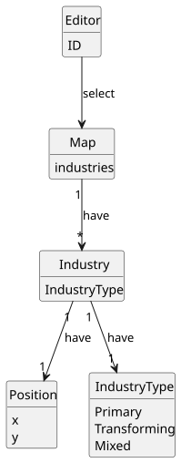

# US02 - As an Editor, I want to add an industry in a position XY of the selected map.

## 2. Analysis

### 2.1. Relevant Domain Model Excerpt 
_In this section, it is suggested to present an excerpt of the domain model that is seen as relevant to fulfill this requirement._

### 2.2. Other Remarks

* A lista de indústrias disponíveis deve ser carregada dinamicamente com base no cenário selecionado (ex: minas, fábricas, portos).
* A posição XY deve ser válida dentro dos limites do mapa (ex: 0 ≤ X < largura_do_mapa, 0 ≤ Y < altura_do_mapa).
* Não deve ser permitido sobrepor indústrias em cidades ou outras indústrias já existentes.
* O sistema deve validar se a indústria selecionada é compatível com o cenário (ex: um porto só pode ser adicionado se o cenário permitir).
* Após a adição, a indústria deve ser exibida visualmente no mapa, com um ícone correspondente ao seu tipo.