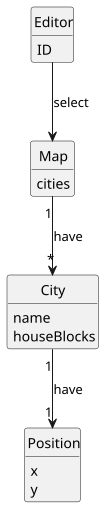

# US03 - As an Editor, I want to add a city in a position XY of the selected map, with a name and a positive number of house blocks.

## 2. Analysis

### 2.1. Relevant Domain Model Excerpt 
_In this section, it is suggested to present an excerpt of the domain model that is seen as relevant to fulfill this requirement._

### 2.2. Other Remarks

* O nome da cidade deve ser único no mapa para evitar conflitos.

* O número de blocos habitacionais deve influenciar a geração de passageiros e carga no simulador (ex: mais blocos = maior demanda).

* A posição XY deve ser válida dentro dos limites do mapa e não pode sobrepor outras cidades ou indústrias.

* Se os blocos forem gerados automaticamente (distribuição normal), o sistema deve garantir que eles estejam próximos ao centro da cidade.

* O nome da cidade deve ser exibido no mapa, junto com um indicador visual (ex: ícone de cidade).

* Validações devem garantir que:
  * O nome não contenha caracteres especiais ou números. 
  * O número de blocos seja positivo (blocos > 0).