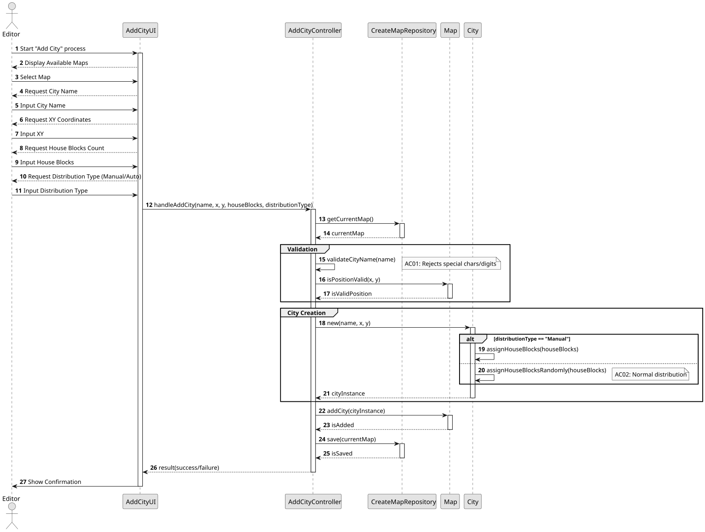
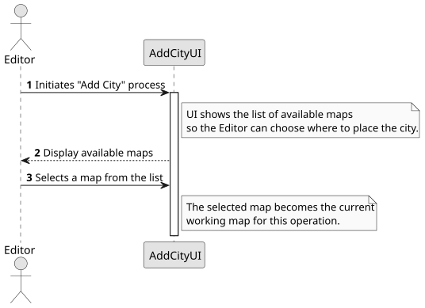
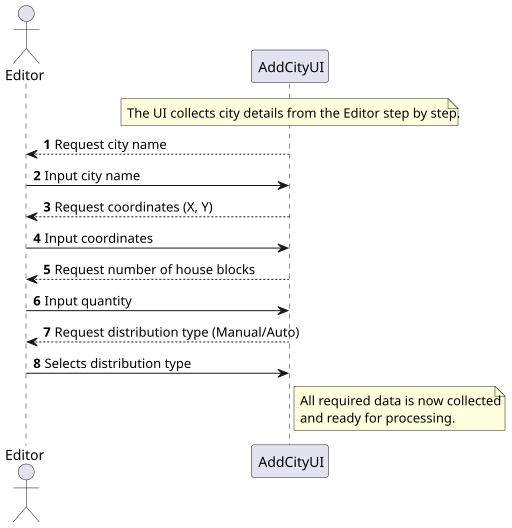
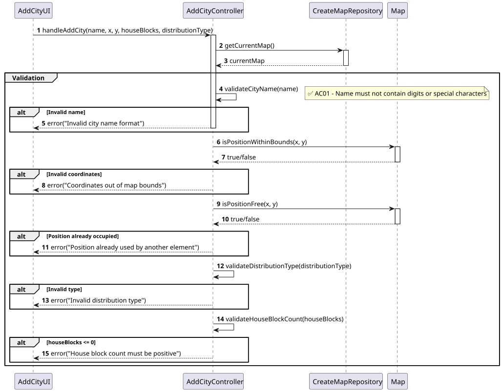
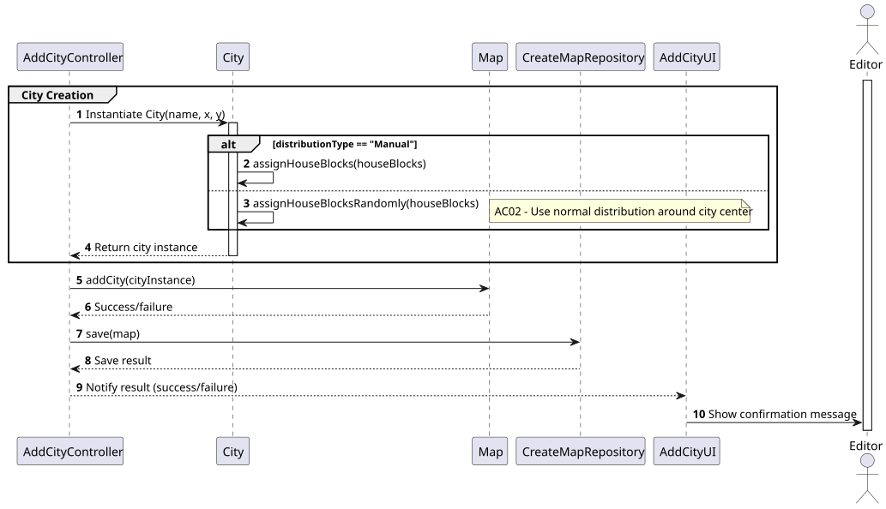
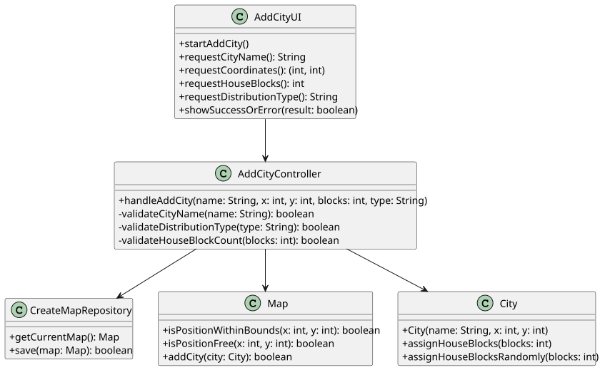

# US03 - As an Editor, I want to add a city in a position XY of the selected map, with a name and a positive number of house blocks.

## 3. Design

### 3.1. Rationale

**The rationale grounds on the SSD interactions and the identified input/output data.**

| Interaction ID | Question: Which class is responsible for...                                   | Answer            | Justification (with patterns)                                                                                                          |
|:---------------|:------------------------------------------------------------------------------|:------------------|:---------------------------------------------------------------------------------------------------------------------------------------|
| Step 1         | Interacting with the actor (Editor)?                                          | AddCityUI         | **Pure Fabrication**: UI class handles user interaction.                                                                               |
|                | Coordinating the US?                                                          | AddCityController | **Controller**: mediates between UI and domain logic.                                                                                  |
|                | Knowing the current map?                                                      | MapRepository     | **Information Expert**: Repository holds and returns the current map.                                                                 |
| Step 2         | Validating the city name (no special characters, no digits)?                  | AddCityController | **IE**: Validation logic resides in the controller.                                                                                    |
| Step 3         | Validating the coordinates (within bounds)?                                   | Map               | **IE**: The map knows its own dimensions and spatial constraints.                                                                     |
|                | Checking if coordinates are available (not occupied)?                         | Map               | **IE**: Only the map knows what already exists on it.                                                                                  |
| Step 4         | Validating the number of house blocks?                                        | AddCityController | **IE**: Controller applies rules for valid house block numbers.                                                                       |
|                | Validating the distribution type?                                             | AddCityController | **IE**: Controller ensures only “Manual” or “Auto” values are accepted.                                                               |
| Step 5         | Creating the City instance?                                                   | City              | **Creator**: The domain object is instantiated by the controller and configured directly.                                             |
|                | Assigning house blocks (manually or randomly)?                                | City              | **IE**: City knows how to assign its house blocks based on the distribution mode.                                                     |
| Step 6         | Adding the city to the map?                                                   | Map               | **Creator / IE**: Map contains cities and knows where/how to place them.                                                              |
| Step 7         | Persisting the updated map after changes?                                     | MapRepository     | **Repository**: Responsible for saving map state after modifications.                                                                 |
| Step 8         | Displaying the operation result to the user (success or error)?               | AddCityUI         | **Pure Fabrication**: UI class displays feedback and messages.                                                                        |

### Systematization ##

According to the taken rationale, the conceptual classes promoted to software classes are:

* City
* Map

Other software classes (i.e. Pure Fabrication) identified:

* AddCityUI
* AddCityController
* MapRepository

## 3.2. Sequence Diagram (SD)

### Full Diagram
This diagram shows the full sequence of interactions between the classes involved in the realization of this user story.

### Partial Diagrams

#### Select Map
This diagram shows the interaction where the Editor selects the map from a list.

#### Collect the City Data

This diagram shows the interaction where the Editor inputs the city data.

#### Input Validation Phase
This diagram shows how the system creates a new city and assigns the house blocks either manually or randomly.

####  Create City & Add to Map
This diagram illustrates how the created city is added to the map and the updated map is saved in the repository.

## 3.3. Class Diagram (CD)

This diagram shows the main software classes involved in fulfilling the requirements of US03 and their relationships.

