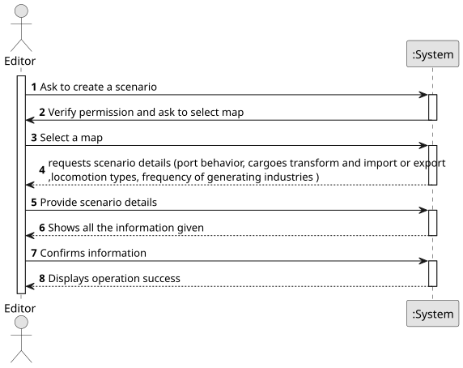

# US04 - As an Editor, I want to create a scenario for a selected map.

## 1. Requirements Engineering

### 1.1. User Story Description

As an Editor, I want to create a scenario for a selected map

### 1.2. Customer Specifications and Clarifications 

**From the specifications document:**

>  Each scenario is characterized by a reference to an existing map

> A scenario defines a valid time range for the simulation.

> A scenario may include historical events that affect gameplay

> A scenario determines which locomotives and industries are available, which influences gameplay by enabling or restricting certain options.

**From the client clarifications:**

> **Question:** Are the rates of production and quantity produce from industries decided in the scenario's specifications?
>
> **Answer:** The rates are predefined values but can be redefined in the scenario.

> **Question:**
In the acceptance criterion 3, it talks about "the factors that alter the generation (frequency) of generating industries", what exactly are these factors? Are we talking about the rate at which these industries produce resources? or is it something else?
>
> **Answer:** 
The generation rates of the industries can be defined in a configuration file, it is not expected that there will be any US to edit them.
Each entry must define the industry and the number of cargos generated per unit of time like year or month.
(e.g., CoalMine, 4)

### 1.3. Acceptance Criteria

* **AC1:** Definition of the behavior of ports, which cargoes they import/
  export and/or transform.
* **AC2:** Definition of the available locomotion types (steam, diesel,
  and/or electric).
* **AC3:** (Re)Definition of the factors that alter the generation (frequency)
  of generating industries.

### 1.4. Found out Dependencies

* There is a dependency on "US01 - As an Editor, I want to create a map with a size and a name" because a scenario must be linked to a specific map. Without a previously created map, it would not be possible to define a scenario or assign restrictions and configurations to it.

* There is a dependency on "US02 - "As an Editor, I want to add an industry (selected from the
  available industries) in a position XY of the selected (current) map" because the generation behavior of industries, including production rates and the types of cargo they handle, can only be meaningfully configured if the industries are already present on the map.

### 1.5 Input and Output Data

**Input Data:**

* Typed data:
    * Scenario name
    * Informal description
    * Technological restrictions (e.g., available locomotives and industries)
    * Historical restrictions (e.g., war, vaccination campaign…)
    * Time restrictions (start and end year)
    * Port configuration (what they import/export/transform)

* Selected data:
    * Map (from the list of existing maps)

**Output Data:**

* Success or failure of the scenario creation operation
* Request scenario details

### 1.6. System Sequence Diagram (SSD)

_Insert here a SSD depicting the envisioned Actor-System interactions and throughout which data is inputted and outputted to fulfill the requirement. All interactions must be numbered._

### 1.7 Other Relevant Remarks

Objects should be movable