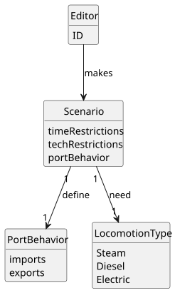

# US04 - As an Editor, I want to create a scenario for a selected map.

## 2. Analysis

### 2.1. Relevant Domain Model Excerpt 
_In this section, it is suggested to present an excerpt of the domain model that is seen as relevant to fulfill this requirement._

### 2.2. Other Remarks
**Core Configuration Elements:**
- **Port Behavior**: Defines imports/exports for mixed industries
- **Locomotion Types**: Steam/Diesel/Electric availability
- **Time Restrictions**: Historical period constraints
- **Tech Restrictions**: Era-appropriate technologies

**Relationships:**
- 1 Editor creates multiple Scenarios
- 1 Scenario defines 1 PortBehavior configuration
- 1 Scenario requires 1+ LocomotionTypes

**Key Constraints:**
- Electric locomotion requires electrified lines
- Port behaviors affect cargo generation
- Time restrictions limit available technologies