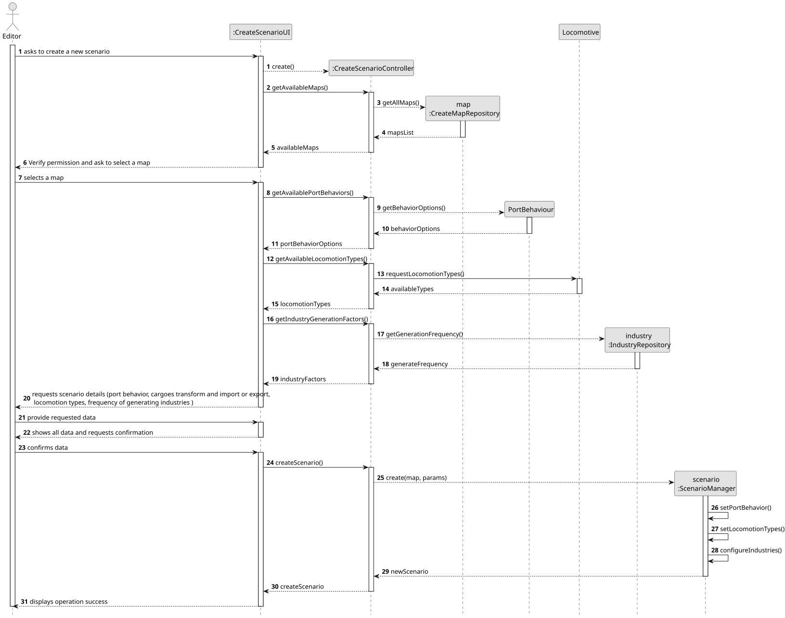
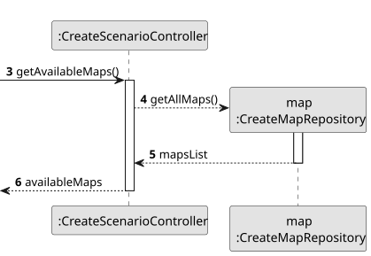

# US04 - As an Editor, I want to create a scenario for a selected map

## 3. Design

### 3.1. Rationale

**The rationale grounds on the SSD interactions and the identified input/output data.**
Of course, here is the refactored table with 18 steps, translated into English:

| Interaction ID | Question: Which class is responsible for...                                                       | Answer                      | Justification (with GRASP patterns)                                                                      |
|:---------------|:--------------------------------------------------------------------------------------------------|:----------------------------|:---------------------------------------------------------------------------------------------------------|
| Step 1         | ... interacting with the Editor (user)?                                                           | `CreateScenarioUI`          | **Pure Fabrication**: Solely responsible for the user interface and interaction.                         |
| Step 2         | ... coordinating the overall scenario creation use case flow?                                     | `CreateScenarioController`  | **Controller**: Orchestrates system operations for the "Create Scenario" use case.                       |
| Step 3         | ... obtaining the singleton instance of all repositories?                                         | `Repositories`              | **Singleton**: Ensures a single point of access to all repositories.                                     |
| Step 4         | ... providing access to the authentication repository?                                            | `Repositories`              | **Information Expert**: Knows about and provides access to the `AuthenticationRepository`.               |
| Step 5         | ... providing access to the organization repository?                                              | `Repositories`              | **Information Expert**: Knows about and provides access to the `OrganizationRepository`.                 |
| Step 6         | ... providing access to the map repository?                                                       | `Repositories`              | **Information Expert**: Knows about and provides access to the `MapRepository`.                          |
| Step 7         | ... providing access to the scenario repository?                                                  | `Repositories`              | **Information Expert**: Knows about and provides access to the `ScenarioRepository`.                     |
| Step 8         | ... retrieving all available maps for selection?                                                  | `MapRepository`             | **Repository**: Responsible for accessing and retrieving persisted `Map` objects.                        |
| Step 9         | ... converting domain `Map` objects into `MapDTO`s for UI presentation?                           | `MapDTO`                    | **Pure Fabrication**: A class created to facilitate data transfer between layers.                        |
| Step 10        | ... requesting specific scenario details (name, start/end years, locomotive types) from the user? | `CreateScenarioUI`          | **Pure Fabrication**: Responsible for collecting user input.                                             |
| Step 11        | ... creating a new instance to configure port behavior?                                           | `CreateScenarioController`  | **Creator**: Responsible for creating necessary `PortBehavior` instances.                                |
| Step 12        | ... adding specific cargo types to the port behavior configuration?                               | `PortBehavior`              | **Information Expert**: Possesses the data and logic to manage port cargo configurations.                |
| Step 13        | ... loading applicable historical events based on the scenario's start year?                      | `HistoricalEventRepository` | **Information Expert / Repository**: Responsible for finding and accessing historical events.            |
| Step 14        | ... converting domain `HistoricalEvent` objects into `HistoricalEventDTO`s for presentation?      | `HistoricalEventDTO`        | **Pure Fabrication**: A class created to facilitate data transfer of historical event data.              |
| Step 15        | ... checking if the current user is authenticated/logged into the system?                         | `CurrentUserSession`        | **Information Expert**: Possesses knowledge about the user's session state.                              |
| Step 16        | ... retrieving the organization associated with the current user/employee?                        | `OrganizationRepository`    | **Repository**: Responsible for accessing and retrieving `Organization` objects related to the employee. |
| Step 17        | ... creating a new `Scenario` instance with the collected data?                                   | `CreateScenarioController`  | **Creator**: Responsible for instantiating the `Scenario` object based on provided data.                 |
| Step 18        | ... storing the newly created scenario in the system?                                             | `ScenarioRepository`        | **Repository**: Responsible for persisting the new `Scenario` object.                                    |
### Systematization ##

According to the taken rationale, the conceptual classes promoted to software classes are:

* Scenario
* Map
* Organization
* TransportSystem
* Port
* Industry

Other software classes (i.e. Pure Fabrication) identified:

* CreateScenarioUI
* CreateScenarioController
* ScenarioValidator
* ScenarioManager
* ScenarioRepository
* MapRepository
* PortRepository
* IndustryRepository
* PortManager
* IndustryManager

# 3.2. Sequence Diagram (SD)

# Partial Diagrams

## Split Diagram

## Get Map

## Port Behavior

## Locomotive Types

## Industry Factors

## Create a Scenario

# 3.3. Class Diagram (CD)

