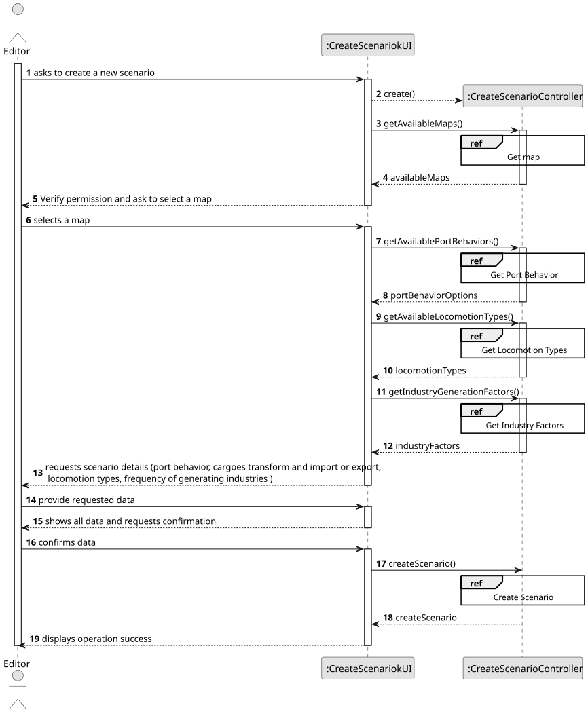
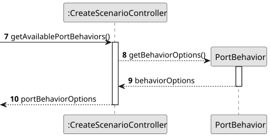
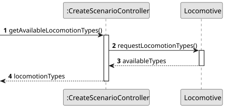
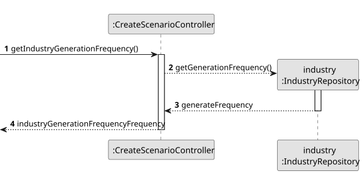
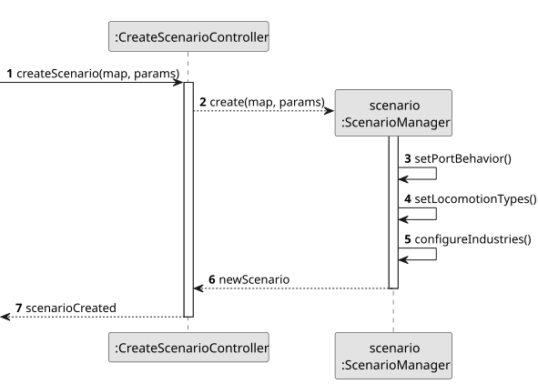
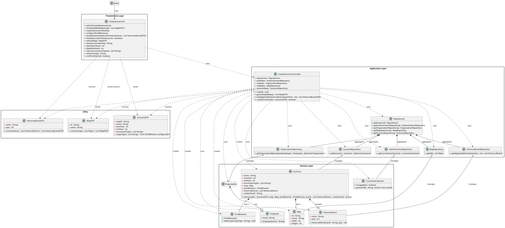

# US04 - As an Editor, I want to create a scenario for a selected map

## 3. Design

### 3.1. Rationale

**The rationale grounds on the SSD interactions and the identified input/output data.**

| Interaction ID | Question: Which class is responsible for...                      | Answer                  | Justification (with patterns)                                                                                                                           |
|:---------------|:-----------------------------------------------------------------|:------------------------|:--------------------------------------------------------------------------------------------------------------------------------------------------------|
| Step 1         | ... interacting with the Editor?                                 | CreateScenarioUI        | Pure Fabrication: separates UI responsibility from domain logic.                                                                                        |
| Step 2         | ... coordinating the flow of the use case?                       | CreateScenarioController| Controller: mediates between UI and domain logic.                                                                                                       |
| Step 3         | ... requesting scenario details from the user?                   | CreateScenarioUI        | Information Expert: handles user input.                                                                                                                 |
| Step 4         | ... validating the scenario parameters?                          | ScenarioValidator       | Strategy Pattern: encapsulates validation rules that can vary independently.                                                                            |
| Step 5         | ... getting available maps?                                      | MapRepository           | Repository: handles persistence and retrieval of map data.                                                                                              |
| Step 6         | ... getting available port behaviors?                            | PortRepository          | Information Expert: knows about port configuration options.                                                                                             |
| Step 7         | ... getting available locomotion types?                          | TransportSystem         | Information Expert: knows about transport types available.                                                                                              |
| Step 8         | ... getting industry generation factors?                         | IndustryRepository      | Information Expert: knows about industry configuration options.                                                                                         |
| Step 9         | ... verifying user permissions?                                  | Organization            | Information Expert: manages user roles and permissions.                                                                                                |
| Step 10        | ... creating and managing the scenario?                          | ScenarioManager         | Controller: coordinates scenario creation and subsystem configuration.                                                                                  |
| Step 11        | ... configuring port behaviors?                                  | PortManager             | Information Expert: manages port configurations.                                                                                                        |
| Step 12        | ... configuring locomotion types?                                | TransportSystem         | Information Expert: manages transport type configurations.                                                                                             |
| Step 13        | ... configuring industries?                                      | IndustryManager         | Information Expert: manages industry configurations.                                                                                                   |
| Step 14        | ... storing the created scenario?                                | ScenarioRepository      | Repository: handles persistence with transaction support.                                                                                              |
| Step 15        | ... informing the result of the operation to the UI?             | CreateScenarioController| Controller: relays outcomes between layers.                                                                                                             |
| Step 16        | ... displaying success/error messages?                           | CreateScenarioUI        | Information Expert: manages user feedback.                                                                                                              |

### Systematization ##

According to the taken rationale, the conceptual classes promoted to software classes are:

* Scenario
* Map
* Organization
* TransportSystem
* Port
* Industry

Other software classes (i.e. Pure Fabrication) identified:

* CreateScenarioUI
* CreateScenarioController
* ScenarioValidator
* ScenarioManager
* ScenarioRepository
* MapRepository
* PortRepository
* IndustryRepository
* PortManager
* IndustryManager

# 3.2. Sequence Diagram (SD)

# Partial Diagrams

## Split Diagram

## Get Map

## Port Behavior

## Locomotive Types

## Industry Factors

## Create a Scenario

# 3.3. Class Diagram (CD)

