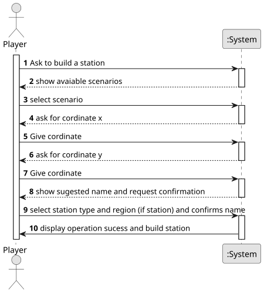

# US05 - As a Player, I want to build a station.

## 1. Requirements Engineering

_In this section, it is suggested to capture the requirement description and specifications as provided by the client as well as any further clarification on it. It is also suggested to capture the requirements acceptance criteria and existing dependencies to other requirements. Finally, identify the involved input and output data and depict an Actor-System interaction in order to fulfill the requirement._

### 1.1. User Story Description

As a Player, I want to build a station
### 1.2. Customer Specifications and Clarifications 

As the **PLAYER**, we should be able to build a Station, choose type of building and name, and centre if is a statio\
Position; Station type (Terminal, Station or Depot) and, in the case of the station, the center must be filled in. If the proposed is not accepted an alternative one must be entered.\
Overbuilding in the Editor is possible, the existing building is replaced for the new one;\
Overbuilding in the Simulator is NOT possible, the player gets a warning and games continues.\
 A player can build depots, stations and terminal as far he have available budget and there no overbuilding.

### 1.3. Acceptance Criteria

AC1: Overbuilding is not possible

### 1.4. Found out Dependencies

Map Selected (US01, US02, US03)
### 1.5 Input and Output Data

Input: Type of building, map, centre, name\
Output: map confirmation, building confirmation, building confirmation and name confirmation

### 1.6. System Sequence Diagram (SSD)

_Insert here a SSD depicting the envisioned Actor-System interactions and throughout which data is inputted and outputted to fulfill the requirement. All interactions must be numbered._

### 1.7 Other Relevant Remarks

Building can be depot, terminal or station
If is a station the player can choose a centre  (NE,SE,NW,SW), otherwise is the geometric centre