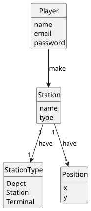

# US05 - As a Player, I want to build a station. 

## 2. Analysis

### 2.1. Relevant Domain Model Excerpt

### 2.2. Other Remarks

Player have to choose the centre for the station (only)\
If the proposed is not accepted an alternative one must be entered.\
Overbuilding in the Editor is possible, the existing building is replaced for the new one;\
Overbuilding in the Simulator is not possible, the player gets a warning and games continues.\
 a player can build depots, stations and terminal as far he have available budget and there no overbuilding.
