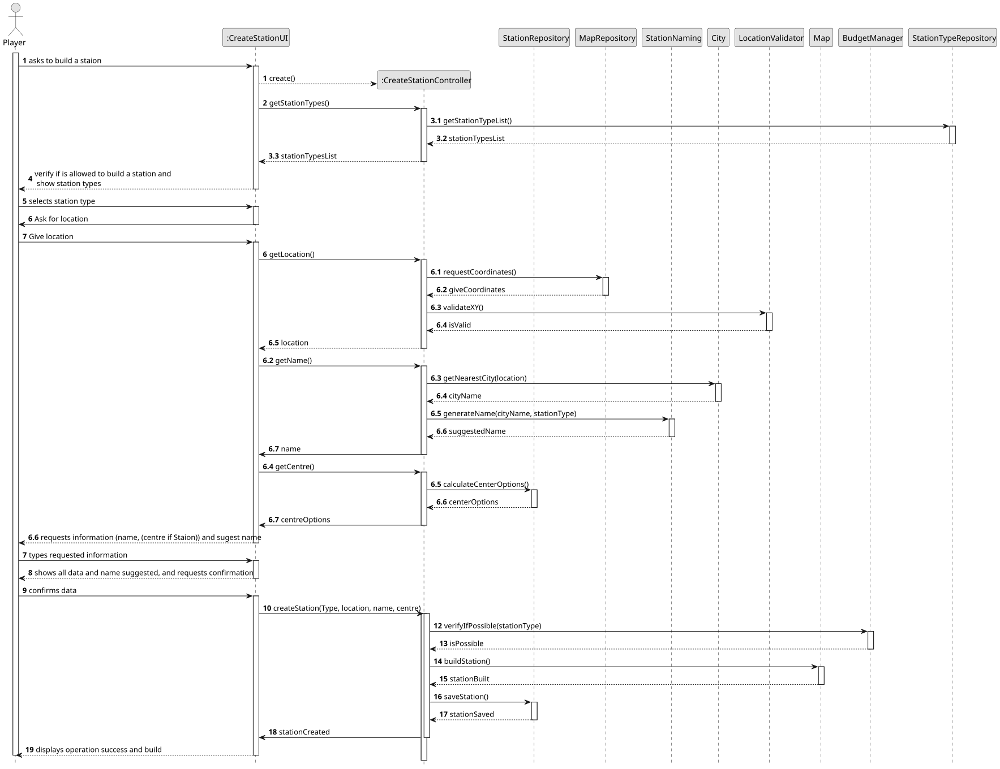
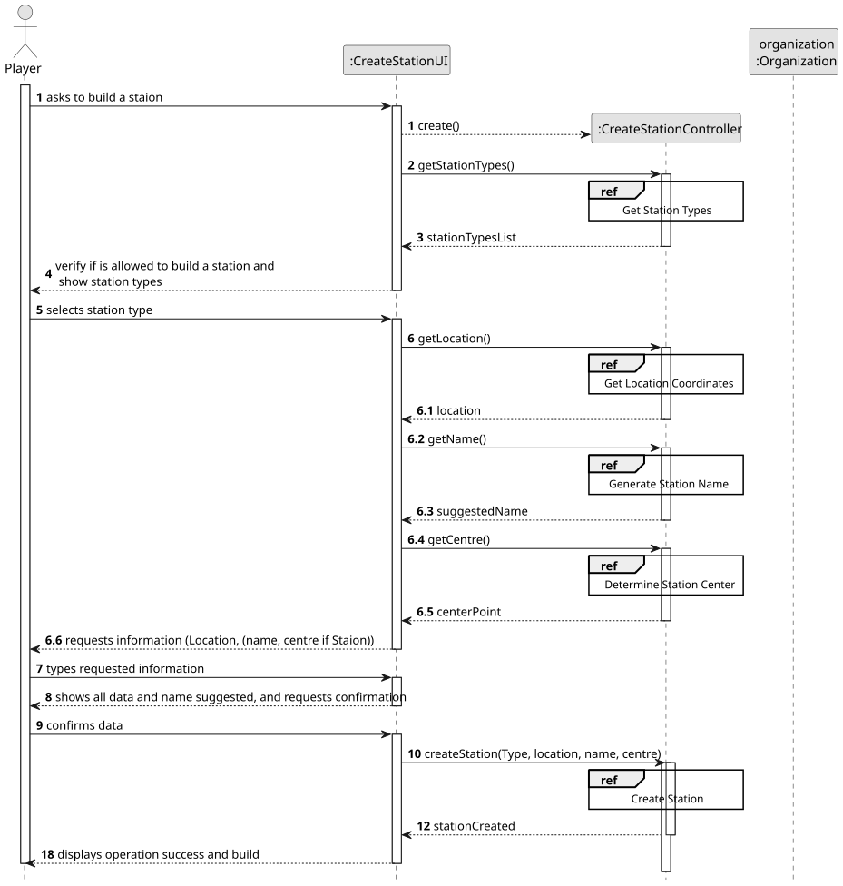
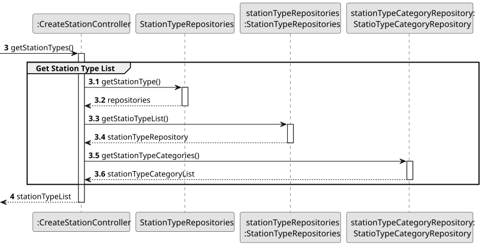
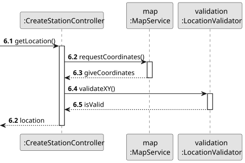
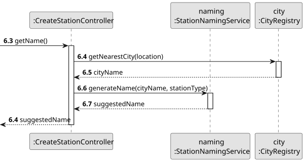
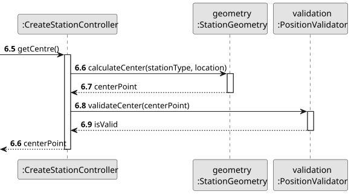
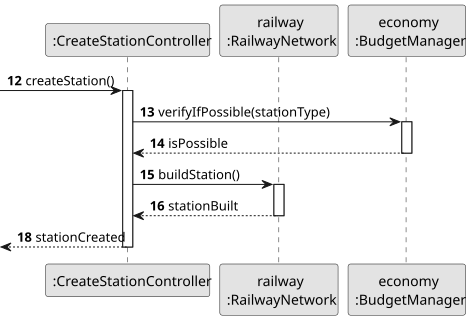
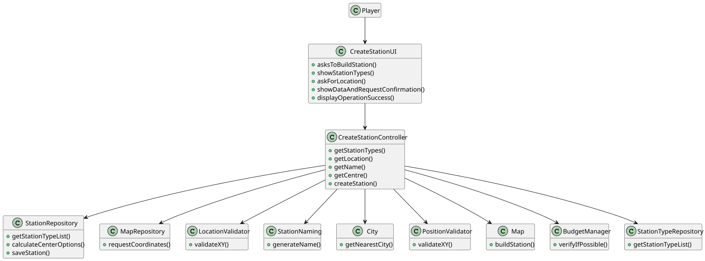

# US05 - As a Player, I want to build a station.

## 3. Design

### 3.1. Rationale

**The rationale grounds on the SSD interactions and the identified input/output data.**

| Interaction ID | Question: Which class is responsible for... | Answer  | Justification (with patterns)  |
|:-------------  |:--------------------- |:------------|:---------------------------- |
| Step 1         | ... initiating the station creation process?                     | CreateStationUI         | Pure Fabrication: handles user interface interactions.                                                                                                  |
| Step 2         | ... coordinating the station creation workflow?                  | CreateStationController | Controller: mediates between UI and domain logic.                                                                                                       |
| Step 3         | ... retrieving available station types?                          | StationTypeRepository   | Information Expert: knows all station types and their properties.                                                                                       |
| Step 4         | ... displaying station type options to the player?               | CreateStationUI         | Pure Fabrication: presents information to the user.                                                                                                     |
| Step 5         | ... collecting the desired station location?                     | CreateStationUI         | Information Expert: handles user input.                                                                                                                 |
| Step 6         | ... validating the station location?                             | LocationValidator       | Strategy Pattern: encapsulates validation rules for station placement.                                                                                  |
| Step 7         | ... generating the station name based on nearby city?            | StationNaming           | Creator: generates names according to business rules.                                                                                                   |
| Step 8         | ... determining the station center position?                     | CreateStationController | Controller: coordinates business logic for station placement.                                                                                           |
| Step 9         | ... verifying budget availability?                               | BudgetManager           | Information Expert: manages financial constraints.                                                                                                      |
| Step 10        | ... creating and saving the station instance?                    | StationRepository       | Creator/Repository: handles persistence of station objects.                                                                                             |
| Step 11        | ... updating the map with the new station?                       | Map                     | Information Expert: maintains map state and station locations.                                                                                          |
| Step 12        | ... providing feedback about the operation result?               | CreateStationUI         | Information Expert: manages user feedback.                                                                                                              |

### Systematization ##

According to the taken rationale, the conceptual classes promoted to software classes are:

* Station
* StationType
* City
* Map

Other software classes (i.e. Pure Fabrication) identified:

* CreateStationUI
* CreateStationController
* StationRepository
* StationTypeRepository
* LocationValidator
* PositionValidator
* StationNaming
* BudgetManager

## 3.2. Sequence Diagram (SD)

## Partial Diagrams ##

### Split Diagram ###

### Get Station Type

### Get Location

### Generate Name

### Define Centre

### Create Station

## 3.3. Class Diagram (CD)

