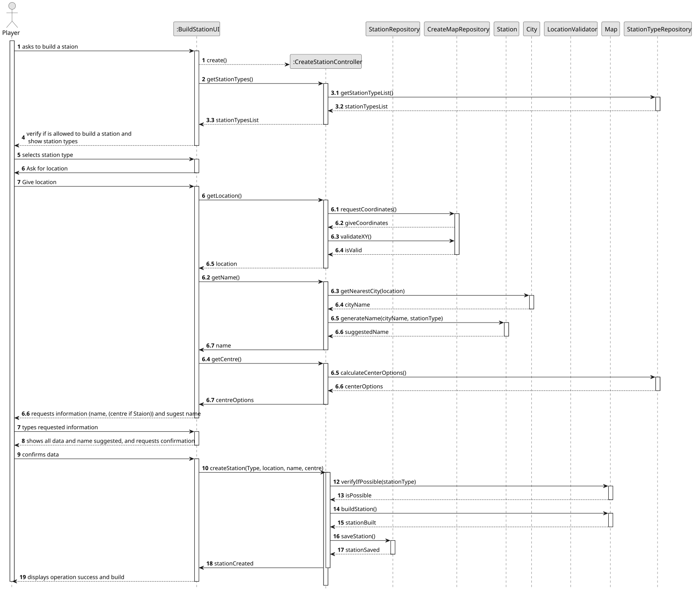
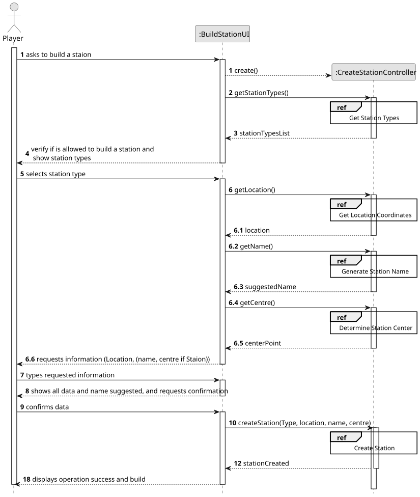
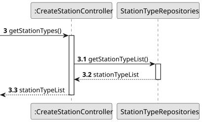
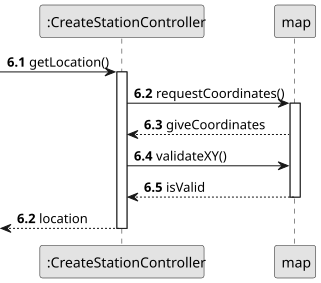
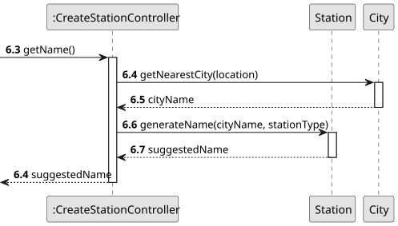
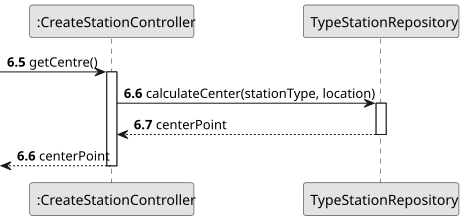
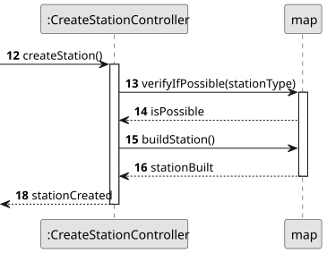
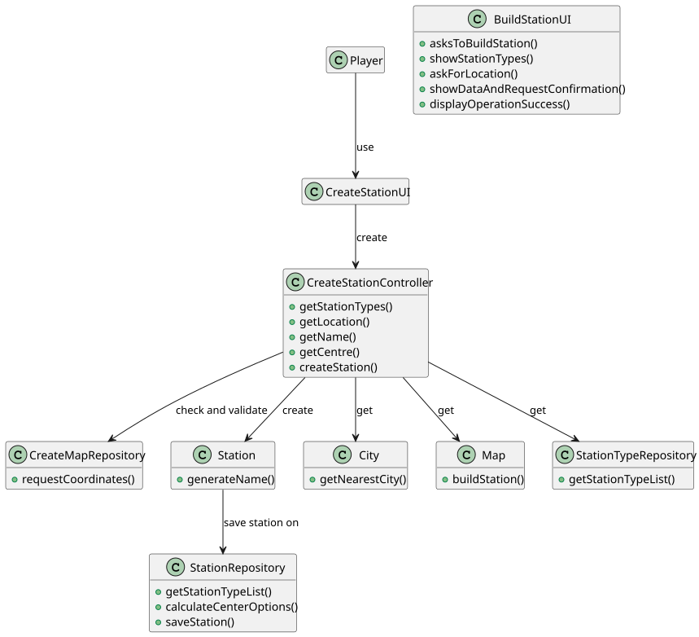

# US05 - As a Player, I want to build a station.

## 3. Design

### 3.1. Rationale

**The rationale grounds on the SSD interactions and the identified input/output data.**
Certainly! Here's the revised table in Markdown format with 10 steps, focusing on the core interactions in the station creation process:

---

| Interaction ID | Question: Which class is responsible for...                        | Answer                     | Justification (with patterns)                                          |
|:---------------|:-------------------------------------------------------------------|:---------------------------|:-----------------------------------------------------------------------|
| Step 1         | ... initiating the station creation process?                       | **BuildStationUI**         | Pure Fabrication: handles user interface interactions.                 |
| Step 2         | ... coordinating the station creation workflow?                    | **BuildStationController** | Controller: mediates between UI and domain logic.                      |
| Step 3         | ... retrieving available station types?                            | **StationTypeRepository**  | Information Expert: knows all station types and their properties.      |
| Step 4         | ... collecting the desired station location (X and Y coordinates)? | **BuildStationUI**         | Information Expert: handles user input.                                |
| Step 5         | ... suggesting a station name based on nearby cities?              | **BuildStationController** | Controller: coordinates business logic for name generation.            |
| Step 6         | ... validating the station location?                               | **LocationValidator**      | Strategy Pattern: encapsulates validation rules for station placement. |
| Step 7         | ... verifying budget availability?                                 | **BudgetManager**          | Information Expert: manages financial constraints.                     |
| Step 8         | ... creating and saving the station instance?                      | **StationRepository**      | Creator/Repository: handles persistence of station objects.            |
| Step 9         | ... updating the map with the new station?                         | **Map**                    | Information Expert: maintains map state and station locations.         |
| Step 10        | ... providing feedback about the operation result?                 | **BuildStationUI**         | Information Expert: manages user feedback.                             |
### Systematization ##

According to the taken rationale, the conceptual classes promoted to software classes are:

* Station
* StationType
* City
* Map

Other software classes (i.e. Pure Fabrication) identified:

* CreateStationUI
* CreateStationController
* StationRepository
* StationTypeRepository
* LocationValidator
* PositionValidator
* StationNaming
* BudgetManager

## 3.2. Sequence Diagram (SD)

## Partial Diagrams ##

### Split Diagram ###

### Get Station Type

### Get Location

### Generate Name

### Define Centre

### Create Station

## 3.3. Class Diagram (CD)

