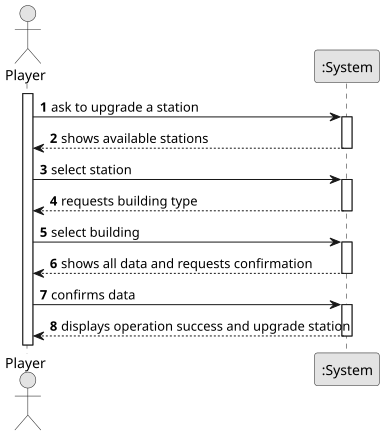

# US06 - As a Player, I want to upgrade a selected station with a building

## 1. Requirements Engineering

### 1.1. User Story Description

As a Player, I want to upgrade a selected station with a building

### 1.2. Customer Specifications and Clarifications 

**From the specifications document:**

> There are no automatic updates; When a new building is available, the player can buy it and then the previous building is replaced.
> There are buildings that are mutually exclusive, such as small restaurants and large restaurants.
> There are buildings that, when they come into existence, it is no longer possible to build the previous one, for example, the telegraph was replaced by the telephone. Stations that have a telegraph continue to have the telegraph in operation until a telephone is built to replace the telegraph. From the moment that a telephone exists, it is no longer possible to build a telegraph.\

**From the client clarifications:**

> **Question:**  Is there a limit on the number of buildings a station can be upgraded with?
> 
> **Answer:** No

>  **Question:** Does the upgrade from telegraph to telephone occur automatically once a certain year is reached?
> 
> **Answewr:** There are no automatic updates; When a new building is available, the player can buy it and then the previous building is replaced.

### 1.3. Acceptance Criteria

* **AC1:** A building can only be added to a station if its availableFrom date is earlier than or equal to the current date of the scenario.
* **AC2:** A building cannot be added if there is already another mutually exclusive building installed at the station.
* **AC3:** If the selected building replaces an existing one (according to the defined replacement rule), the system must automatically remove or replace the existing building.

### 1.4. Found out Dependencies

* There is a dependency on "US04 - As an Editor, I want to create a scenario for a selected map" because the availability of buildings (e.g., Telegraph, Telephone, Hotels) depends on the scenario's curr
* There is a dependency on "US04 - As a Player, I want to build station" because a player can only upgrade a station after that station has been built.

### 1.5 Input and Output Data

**Input Data:**

* Typed data:
    * Building type (e.g., Telegraph, Telephone, SmallHotel…)

* Selected data:
    * Station to be upgraded
      *Building category (if buildings are grouped that way)

**Output Data:**

* List of available building types (filtered by scenario date)
* Summary of entered/selected data for confirmation
* All the available information about scenario

### 1.6. System Sequence Diagram (SSD)

_Insert here a SSD depicting the envisioned Actor-System interactions and throughout which data is inputted and outputted to fulfill the requirement. All interactions must be numbered._

### 1.7 Other Relevant Remarks

Stations can be upgraded with, telegraphs, café, custom, post office, hotel, silo and liquid stations.
hotel and café can be small or large
telegraph can be upgraded to a telephone