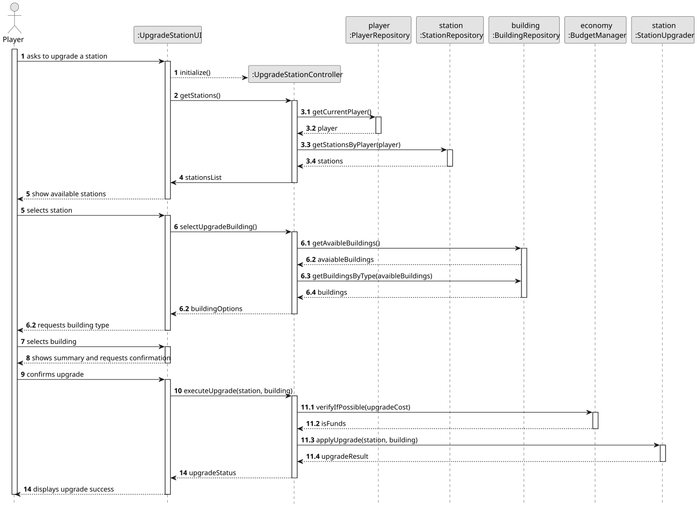
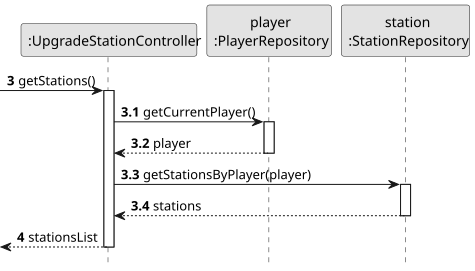
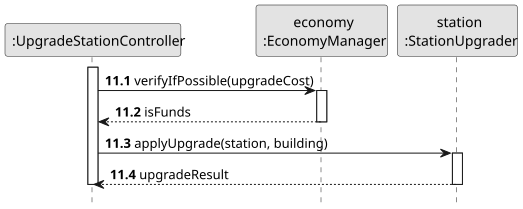
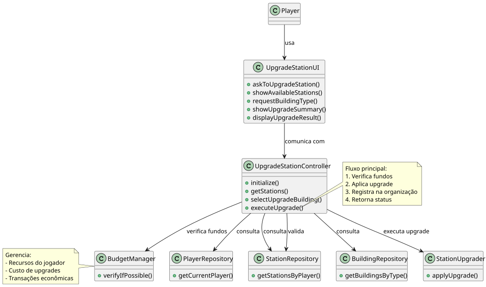

# US06 - As a Player, I want to upgrade a selected station with a building

## 3. Design

### 3.1. Rationale

**The rationale grounds on the SSD interactions and the identified input/output data.**

| Interaction ID | Question: Which class is responsible for... | Answer | Justification (with patterns) |
|:---------------|:--------------------------------------------|:-------|:-----------------------------|
| Step 1 | ... interacting with the Player? | UpgradeStationUI | Pure Fabrication: separates UI responsibility from domain logic |
| Step 2 | ... coordinating the upgrade process? | UpgradeStationController | Controller: mediates between UI and domain logic |
| Step 3 | ... retrieving the current player data? | PlayerRepository | Repository: handles player data persistence |
| Step 4 | ... retrieving available stations? | StationRepository | Information Expert: knows about stations |
| Step 5 | ... retrieving available buildings? | BuildingRepository | Information Expert: knows about building types |
| Step 6 | ... verifying if upgrade is financially possible? | BudgetManager | Information Expert: manages player finances |
| Step 7 | ... executing the station upgrade? | StationUpgrader | Expert: handles upgrade business rules |
| Step 8 | ... validating building availability by date? | BuildingRepository | Information Expert: knows building constraints |
| Step 9 | ... validating mutual exclusivity of buildings? | BuildingRepository | Information Expert: knows building dependencies |
| Step 10 | ... persisting the upgraded station? | StationRepository | Repository: handles station data persistence |
| Step 11 | ... updating player budget? | BudgetManager | Information Expert: manages financial transactions |
| Step 12 | ... providing feedback to the player? | UpgradeStationUI | Pure Fabrication: handles user output |

### Systematization

According to the taken rationale, the conceptual classes promoted to software classes are:

* Player
* Station
* Building
* Budget

Other software classes (i.e. Pure Fabrication) identified:

* UpgradeStationUI
* UpgradeStationController
* PlayerRepository
* StationRepository
* BuildingRepository
* BudgetManager
* StationUpgrader

## 3.2. Sequence Diagram (SD)
* **Full Sequence Diagram**

## Partial Diagrams

* **Split Diagram**

* **Get Stations**

* **Get Upgrade**

* **Upgrade Station**

## 3.3. Class Diagram (CD)

