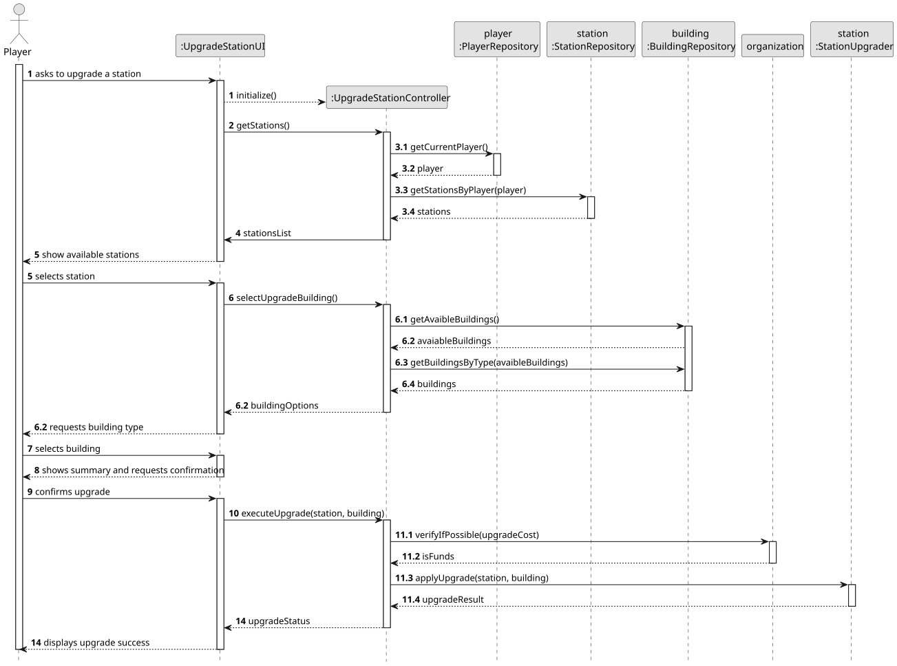
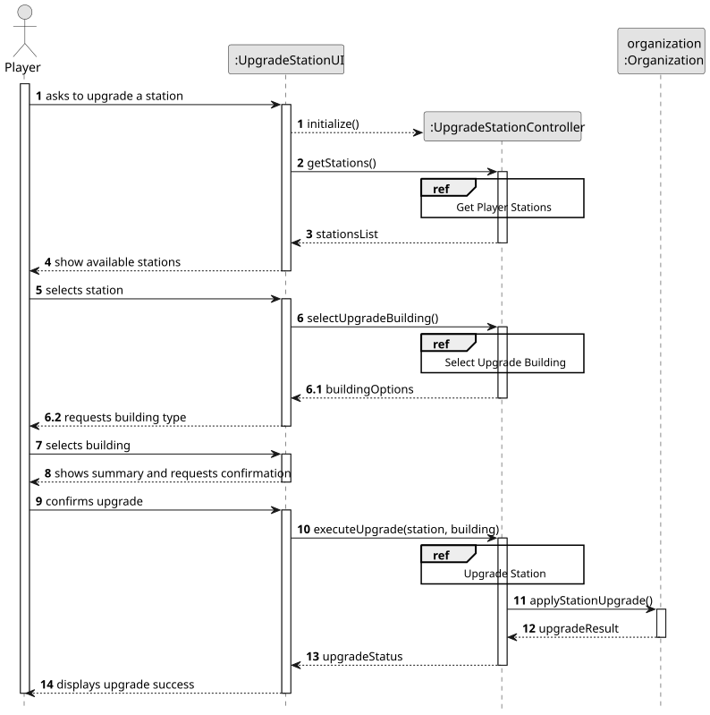
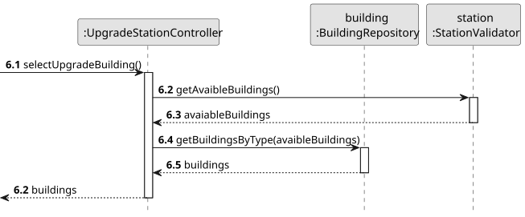
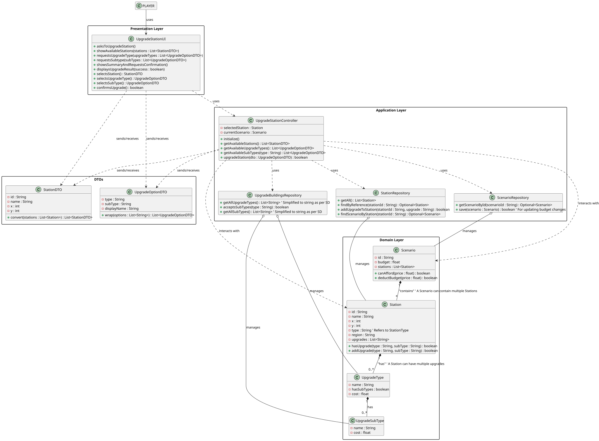

# US06 - As a Player, I want to upgrade a selected station with a building

## 3. Design

### 3.1. Rationale

**The rationale grounds on the SSD interactions and the identified input/output data.**
Here's the refactored table with 10 steps, translated into English, aligning responsibilities and justifications with the provided sequence diagram for the "Upgrade Station" process and GRASP principles:

| Interaction ID | Question: Which class is responsible for...                           | Answer                       | Justification (with GRASP patterns)                                                               |
|:---------------|:----------------------------------------------------------------------|:-----------------------------|:--------------------------------------------------------------------------------------------------|
| Step 1         | ... interacting with the Player?                                      | `UpgradeStationUI`           | **Pure Fabrication**: Separates UI responsibility from domain logic.                              |
| Step 2         | ... coordinating the upgrade process?                                 | `UpgradeStationController`   | **Controller**: Mediates between the UI and domain logic, orchestrating operations.               |
| Step 3         | ... retrieving available stations?                                    | `StationRepository`          | **Repository**: Responsible for persistence and retrieval of `Station` objects.                   |
| Step 4         | ... retrieving available upgrade types and subtypes?                  | `UpgradeBuildingsRepository` | **Information Expert**: Possesses the knowledge about upgrade types and subtypes.                 |
| Step 5         | ... verifying if the upgrade is financially possible?                 | `Scenario`                   | **Information Expert**: Possesses knowledge of its own budget and can verify its sufficiency.     |
| Step 6         | ... executing the upgrade on the station itself (adding the upgrade)? | `Station`                    | **Information Expert**: Knows its own upgrades and is responsible for adding them.                |
| Step 7         | ... checking if an upgrade already exists on the station?             | `Station`                    | **Information Expert**: Knows its own existing upgrades and can verify their presence.            |
| Step 8         | ... persisting the updated station?                                   | `StationRepository`          | **Repository**: Responsible for saving changes to `Station` data.                                 |
| Step 9         | ... updating the scenario budget after the upgrade?                   | `Scenario`                   | **Information Expert**: Possesses knowledge of its budget and is responsible for deducting costs. |
| Step 10        | ... providing feedback to the Player?                                 | `UpgradeStationUI`           | **Pure Fabrication**: Handles the presentation of operation results to the user.                  |

### Systematization

According to the taken rationale, the conceptual classes promoted to software classes are:

* Player
* Station
* Building
* Budget

Other software classes (i.e. Pure Fabrication) identified:

* UpgradeStationUI
* UpgradeStationController
* PlayerRepository
* StationRepository
* BuildingRepository
* BudgetManager
* StationUpgrader

## 3.2. Sequence Diagram (SD)
* **Full Sequence Diagram**

## Partial Diagrams

* **Split Diagram**

* **Get Stations**

* **Get Upgrade**

* **Upgrade Station**

## 3.3. Class Diagram (CD)

