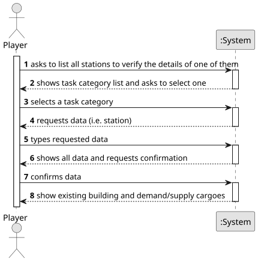

# US07 - As a Player, I want to list all stations to select one and view its details

## 1. Requirements Engineering

### 1.1. User Story Description
As a Player, I want to list all existing stations to:
- Select one to view its complete details
- See available buildings and upgrades
- Check current cargo demand/supply

### 1.2. Customer Specifications and Clarifications
**From Project Specifications:**
- Stations display:
    - Basic info (name, type, position)
    - Current buildings/upgrades
    - Cargo waiting for collection
    - Cargo requested for delivery
- Economic radius affects displayed cargo
- Different station types show different details:
    - Depots (3x3 radius)
    - Stations (4x4 radius, with center position)
    - Terminals (5x5 radius)

**Client Clarifications:**
> **Question:** Should the list show stations from all players or just mine?  
> **Answer:** Shows all stations but highlights player-owned ones

> **Question:** What details appear when selecting a station?  
> **Answer:** Full station profile including:
> - Construction date
> - Upgrade history
> - Current cargo status
> - Buildings present

### 1.3. Acceptance Criteria

**AC1:** Complete Station Listing
- List all stations alphabetically
- Group by station type (Depot/Station/Terminal)
- Highlight player-owned stations

**AC2:** Detailed Station View
- Show all station attributes when selected:
    - Basic info (name, type, coordinates)
    - Buildings/upgrades present
    - Cargo available/requested
    - Economic radius visualization

**AC3:** Cargo Information
- Display cargo ready for collection
- Show cargo demand for delivery
- Update in real-time during simulation

**AC4:** Navigation
- Return to list view from details
- Filter by station type
- Search by station name

### 1.4. Found out Dependencies

- **US05**: Requires station creation functionality
- **US06**: Needs upgrade system for building info
- **US12**: Simulator integration for cargo updates
- **US13**: Station connectivity information

### 1.5. Input and Output Data

**Input:**

*Typed Data*:

* Search/filter term (optional)

*Selected Data*:

* Station type filter (dropdown)
* Sorting (by name/type/date)
* Specific station selection

**Output:**
- Station list (name, type, ownership status)
- Detailed station view:
    - Basic attributes
    - Buildings list
    - Cargo information
    - Visual representation
  
### 1.6. System Sequence Diagram (SSD)

### 1.7. Other Relevant Remarks

1. **Header Section**:
    - Station name/type icon
    - Construction date
    - Ownership indicator

2. **Buildings Panel**:
    - List of installed buildings
    - Upgrade timestamps
    - Visual indicators

3. **Cargo Status**:
    - Available for pickup (quantity/type)
    - Requested for delivery
    - Historical trends

