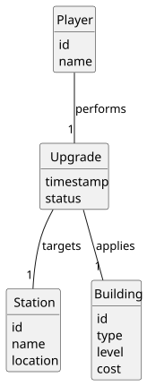

# US07 - As a Player, I want to list all the stations to select one to see its details, including the existing building and the demand/supply cargoes.

## 2. Analysis

### 2.1. Relevant Domain Model Excerpt 

### 2.2. Other Remarks

* The station list should be displayed clearly, sorted alphabetically or by location for easy navigation.  
* Consider adding a summary preview (e.g., station name, type, available cargo) before detailed selection.  
* Ensure efficient loading of station details, especially for maps with many stations, to avoid delays.  
* If stations have dynamic cargo data, implement real-time updates or caching.  
* The design should allow future additions (e.g., new building types or cargo categories) without major changes.  
* Handle scenarios where a station has no buildings/cargo or invalid data gracefully (e.g., display "No data available").  