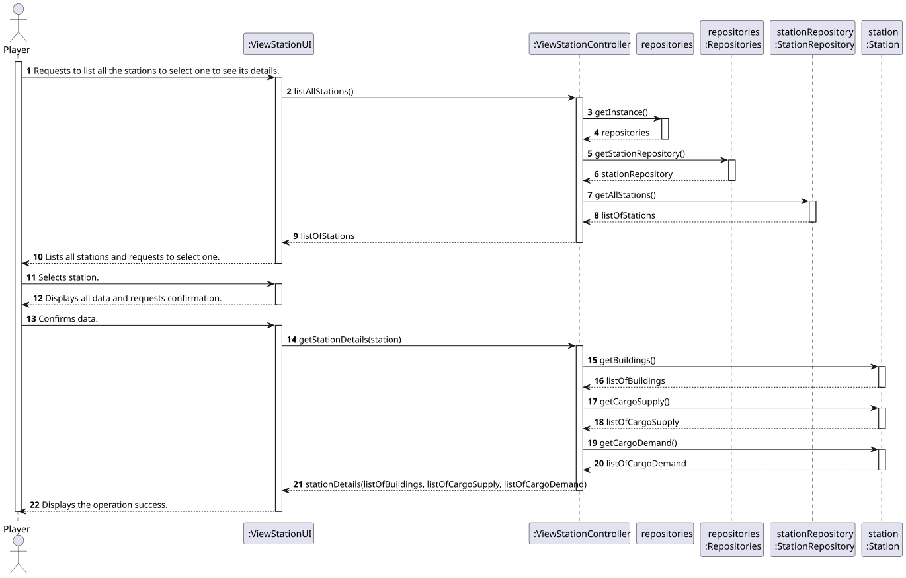
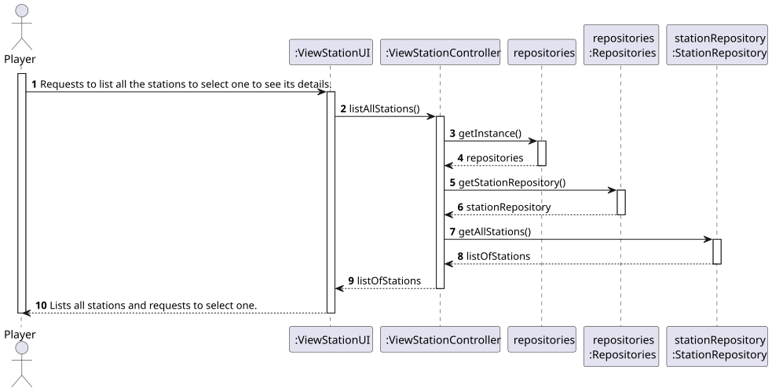
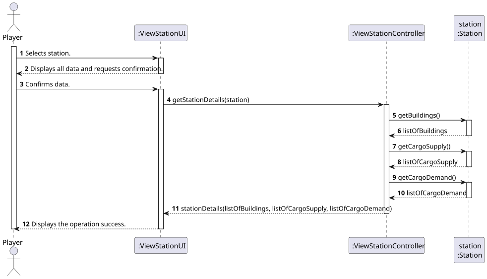
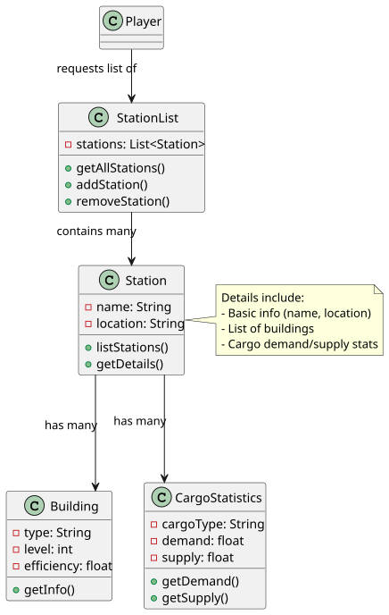

### 3.1. Rationale

**The rationale grounds on the SSD interactions and the identified input/output data.**

| Interaction ID | Question: Which class is responsible for...              | Answer                  |Justification (with patterns)|             
|:---------------|:--------------------------------------------------------|:------------------------|------------------------------|
| Step 1         | ...interacting with the Player?                         | ListStationsUI          |
| Step 2         | ...coordinating the use case flow?                      | ListStationsController  |
| Step 3         | ...retrieving the list of all stations?                 | StationList             |
| Step 4         | ...displaying the station list to the Player?           | ListStationsUI          |
| Step 5         | ...selecting a station from the list?                   | ListStationsUI          |
| Step 6         | ...fetching details of the selected station?            | Station                 |
| Step 7         | ...retrieving cargo demand/supply data?                 | CargoStatistics         |
| Step 8         | ...retrieving building upgrades?                        | Building                |
| Step 9         | ...displaying station details?                          | ListStationsUI          |
| Step 10        | ...handling errors (e.g., invalid selection)?           | ListStationsController  |

### Systematization ##

According to the taken rationale, the conceptual classes promoted to software classes are:

* Station  
* Building  
* CargoStatistics

Other software classes (i.e. Pure Fabrication) identified:

* ListStationsUI  
* ListStationsController  
* StationList

## 3.2. Sequence Diagram (SD)

### Partial Diagram

#### Displaying Station List

#### Select a Station and Retrieving Details

## 3.3. Class Diagram (CD)

