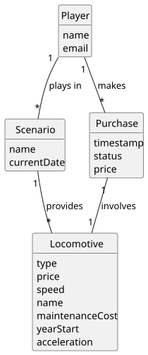

# US09 - As a Player, I want to buy a locomotive

## 2. Analysis

### 2.1. Relevant Domain Model Excerpt

### 2.2. Other Remarks

Locomotives can be of steam, diesel and electricity.
Electric Locomotives need electrified lines
