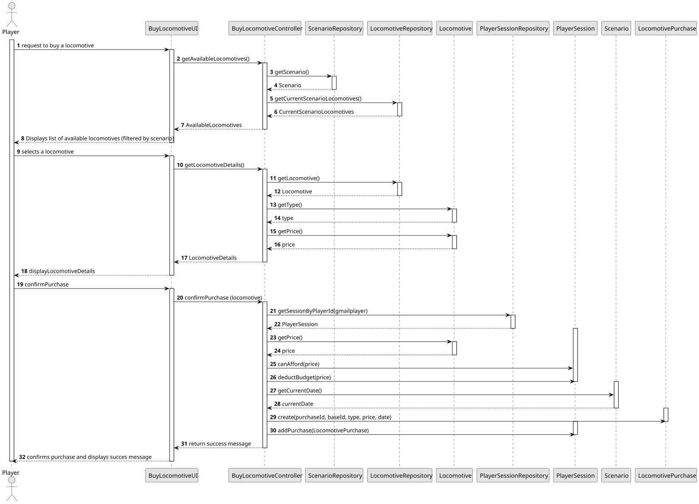
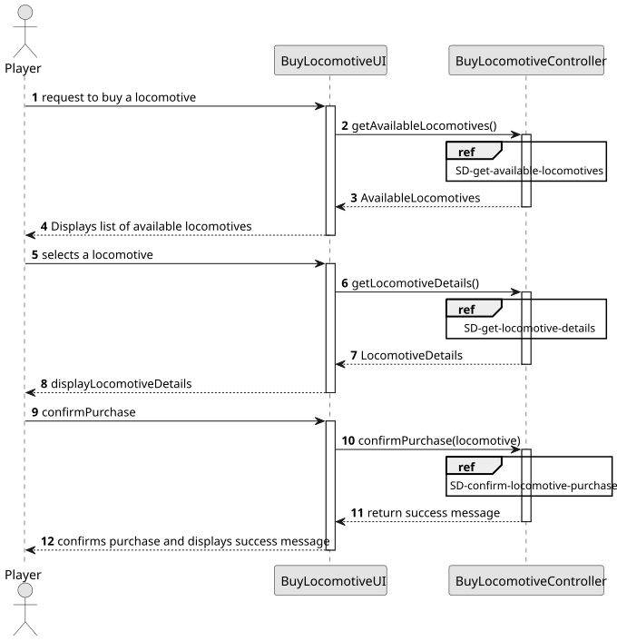
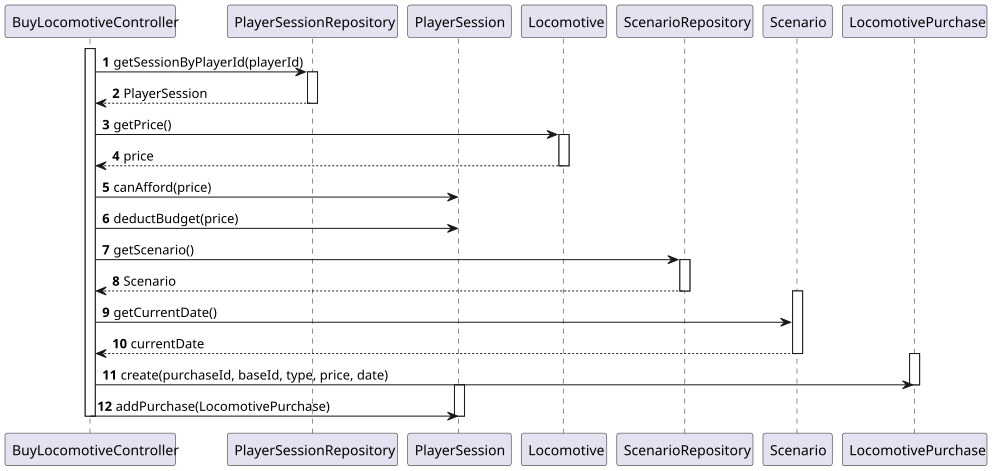
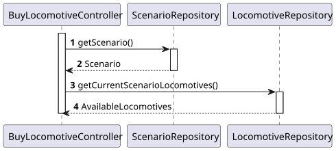
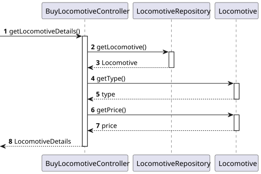
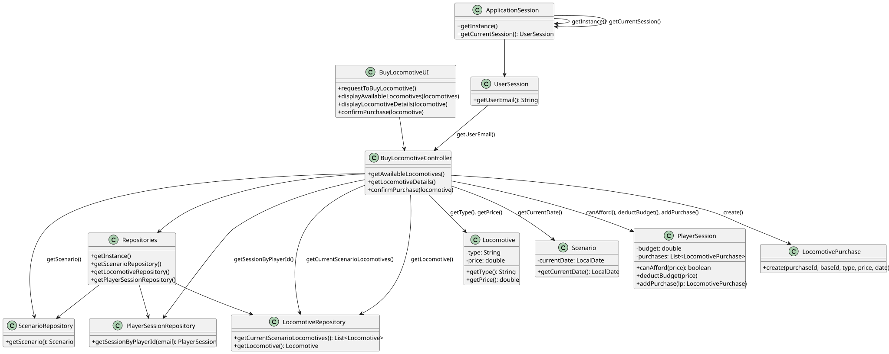

# US09 - As a Player, I want to buy a locomotive.

## 3. Design

### 3.1. Rationale

**The rationale grounds on the SSD interactions and the identified input/output data.**

| Interaction ID | Question: Which class is responsible for...                                                                          | Answer               | Justification (with patterns)                                                                                                           |
|:---------------|:---------------------------------------------------------------------------------------------------------------------|:---------------------|:----------------------------------------------------------------------------------------------------------------------------------------|
| Step 1         | ... interacting with the actor?                                                                                      | BuyLocomotiveUI      | Pure Fabrication: responsible for UI interactions; not a domain class.                                                                  |
|                | ... coordinating the use case?                                                                                       | BuyLocomotiveController | Controller: coordinates the process of buying a locomotive.                                                                             |
|                | ... knowing the player using the system?                                                                             | PlayerSessionRepository |  IE: accesses the PlayerSession associated with the user.                                                                               |
| Step 2         | ... retrieving the current scenario?                                                                                 | ScenarioRepository   | IE: stores and provides access to scenarios.                                                                                            |
|                | ... getting locomotives for the current scenario?                                                                    | LocomotiveRepository | IE: filters locomotives based on scenario.                                                                                              |
| Step 3         | ... retrieving details of a selected locomotive?                                                                     | LocomotiveRepository | IE: knows how to access locomotive objects.                                                                                             |
|                | ... exposing the type and price of the locomotive?                                                                   | Locomotive           | IE: encapsulates its own data like type and price.                                                                                      |
| Step 4         | ... checking if the player can afford the locomotive?                                                                | PlayerSession        | IE: knows the player’s budget and purchases; encapsulates validation logic.                                                             |
|                | ... deducting the price from the budget?                                                                             | PlayerSession        | IE: owns and updates budget state.                                                                                                      |
|                | ... getting the current simulation date?                                                                             | Scenario             | IE: encapsulates the current simulation date.                                                                                           |
|                | ... creating the locomotive purchase object?                                                                         | LocomotivePurchase   | Creator: has all necessary data to instantiate a purchase (player, type, price, date).                                                  |
|                | ... saving the new purchase?                                                                                         | PlayerSession        | IE: manages the list of purchases for the player.                                                                                       |
| Step 5         | ... showing the success message to the player?                                                                       | BuyLocomotiveUI      | Pure Fabrication: handles user feedback and final display.                                                                              |

### Systematization ##

According to the taken rationale, the conceptual classes promoted to software classes are:

* PlayerSession
* Locomotive
* Scenario
* LocomotivePurchase

Other software classes (i.e. Pure Fabrication) identified:

* BuyLocomotiveUI 
* BuyLocomotiveController 
* Repositories 
* LocomotiveRepository 
* PlayerSessionRepository 
* ScenarioRepository 
* ApplicationSession 
* UserSession

## 3.2. Sequence Diagram (SD)

### Full Diagram

This diagram shows the full sequence of interactions between the classes involved in the realization of this user story.

### Split Diagrams

The following diagram shows the same sequence of interactions between the classes involved in the realization of this user story, but it is split in partial diagrams to better illustrate the interactions between the classes.

**Confirm Locomovite Partial SD**

**Get Available Locomotive Partial SD**

**Get Locomotive details Partial SD**

## 3.3. Class Diagram (CD)

