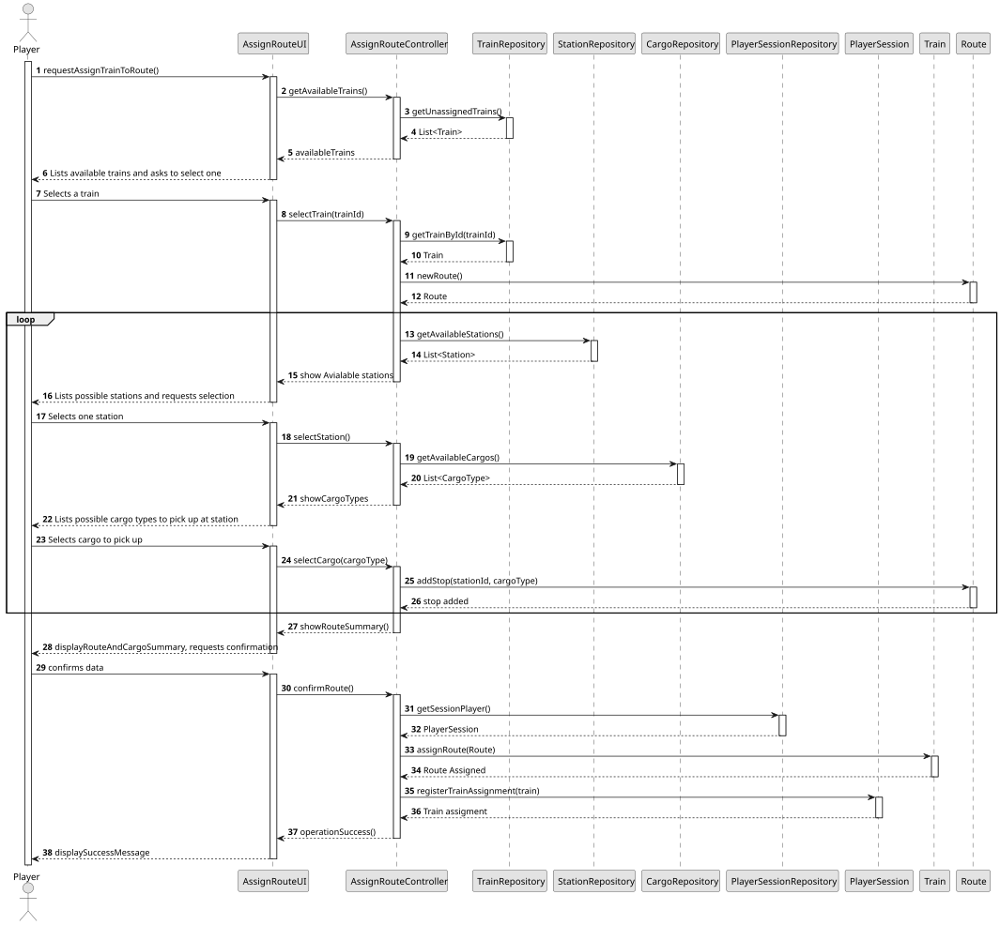
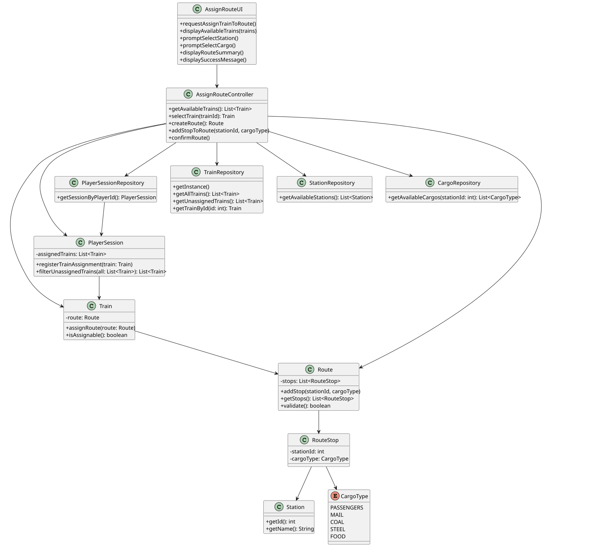

# US010 - As a Player, I want to assign a selected train to a route with valid stations and the respective list of cargoes to be picked up in each station.

## 3. Design

### 3.1. Rationale

**The rationale grounds on the SSD interactions and the identified input/output data.**

| Interaction ID | Question: Which class is responsible for...                                      | Answer                  | Justification (with patterns)                                           |
|----------------|----------------------------------------------------------------------------------|-------------------------|-------------------------------------------------------------------------|
| Step 1         | ... interacting with the actor?                                                  | AssignRouteUI          | **Pure Fabrication**: created solely for UI logic.                     |
| Step 2         | ... coordinating the user story flow?                                            | AssignRouteController  | **Controller**: centralizes the logic and mediates between components. |
| Step 3         | ... listing available trains to assign?                                          | TrainRepository        | **Information Expert (IE)**: manages access to trains.                 |
| Step 4         | ... creating a new route for the selected train?                                 | Route                  | **Creator**: creates and owns stops.                                   |
| Step 5         | ... retrieving all valid stations and available cargo types?                     | StationRepository, CargoRepository | **IE**: each knows its own data.                             |
| Step 6         | ... defining and storing each stop (station + cargo to pick up)?                 | Route                  | **IE + Creator**: encapsulates stop list.                              |
| Step 7         | ... retrieving the player session (to associate action context)?                 | PlayerSessionRepository | **IE**: stores current session; used to identify the player.           |
| Step 8         | ... assigning the route to the selected train and persisting the change?         | Train, TrainRepository | **IE + Low Coupling**: Train knows its route; repo persists updates.  |
| Step 9         | ... informing operation success to the user?                                     | AssignRouteUI          | **IE**: UI is responsible for interaction feedback.                    |
### Systematization ##

According to the taken rationale, the conceptual classes promoted to software classes are:

* Train 
* Route 
* Station 
* CargoType 
* PlayerSession

Other software classes (i.e. Pure Fabrication) identified:

* AssignRouteUI 
* AssignRouteController 
* TrainRepository 
* StationRepository 
* CargoRepository 
* PlayerSessionRepository

## 3.2. Sequence Diagram (SD)

### Split Diagrams

The following diagram shows the same sequence of interactions between the classes involved in the realization of this user story, but it is split in partial diagrams to better illustrate the interactions between the classes.

It uses Interaction Occurrence (a.k.a. Interaction Use).

**Get Task Category List Partial SD**

**Get Task Category Object**

**Get Employee**

**Create Task**

## 3.3. Class Diagram (CD)

_In this section, it is suggested to present an UML static view representing the main related software classes that are involved in fulfilling the requirements as well as their relations, attributes and methods._

