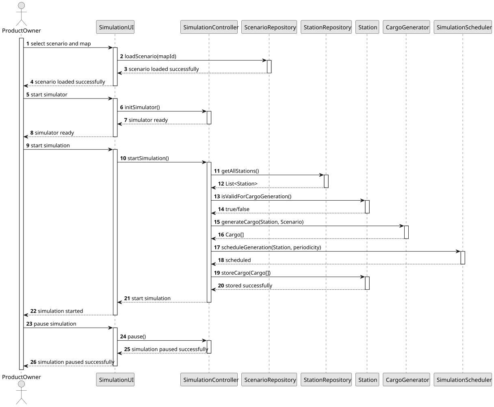
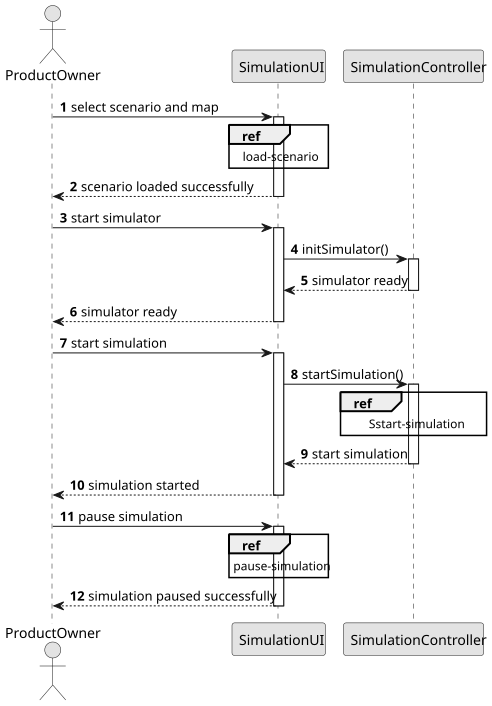
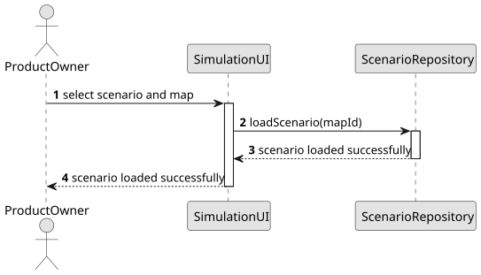
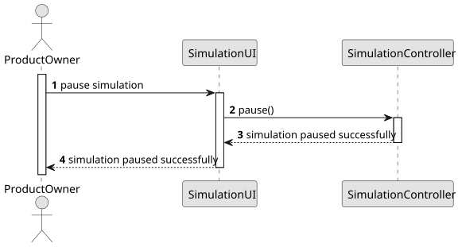
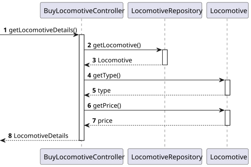

# US12 - As a Product Owner, I want to create a simulator that generates
cargoes at current stations, automatically, considering the cities and
industries that the railway network serves.

## 3. Design

### 3.1. Rationale

**The rationale grounds on the SSD interactions and the identified input/output data.**

| Interaction ID | Question: Which class is responsible for...                                                            | Answer                  | Justification (with GRASP patterns)                                                                 |
|----------------|--------------------------------------------------------------------------------------------------------|--------------------------|------------------------------------------------------------------------------------------------------|
| Step 1         | ... interacting with the Product Owner?                                                                | SimulationUI            | Pure Fabrication: mediates between user and system logic.                                           |
|                | ... coordinating the simulation setup?                                                                 | SimulationController    | Controller: central coordinator for the simulation logic.                                           |
| Step 2         | ... loading the scenario from the selected map?                                                        | ScenarioRepository      | Information Expert: owns the data about scenarios and handles persistence/retrieval.               |
| Step 3         | ... retrieving all stations in the map?                                                                | StationRepository       | Information Expert: encapsulates access to station data.                                            |
| Step 4         | ... checking whether stations are valid for cargo generation?                                          | Station                 | Information Expert: knows its own status and relation to nearby cities/industries.                 |
| Step 5         | ... generating cargo based on scenario and surroundings?                                               | CargoGenerator          | Information Expert: encapsulates the logic for contextual cargo creation.                           |
| Step 6         | ... scheduling periodic generation (fixed or random)?                                                  | SimulationScheduler     | Information Expert: manages time-based execution and scheduling.                                   |
| Step 7         | ... storing cargo at the station (max 24 units)?                                                       | Station                 | Information Expert: owns and manages the stored cargo.                                              |
| Step 8         | ... showing the simulation has started?                                                                | SimulationUI            | Pure Fabrication: responsible for communicating status to the user.                                |
| Step 9         | ... pausing the simulation?                                                                            | SimulationController    | Controller: responsible for simulation control actions.                                             |
| Step 10        | ... showing the simulation has been paused successfully?                                               | SimulationUI            | Pure Fabrication: UI component handles final user feedback.                                         |

### Systematization ##

According to the taken rationale, the conceptual classes promoted to software classes are:

* Station 
* Scenario

Other software classes (i.e. Pure Fabrication) identified:

* SimulationUI 
* SimulationController 
* ScenarioRepository
* StationRepository 
* CargoGenerator 
* SimulationScheduler

## 3.2. Sequence Diagram (SD)

_In this section, it is suggested to present an UML dynamic view representing the sequence of interactions between software objects that allows to fulfill the requirements._

### Split Diagrams

The following diagram shows the same sequence of interactions between the classes involved in the realization of this user story, but it is split in partial diagrams to better illustrate the interactions between the classes.

**Load Scenario Partial SD**

** Pause Simulation Partial SD**

**Get Locomotive details Partial SD**

## 3.3. Class Diagram (CD)

_In this section, it is suggested to present an UML static view representing the main related software classes that are involved in fulfilling the requirements as well as their relations, attributes and methods._

